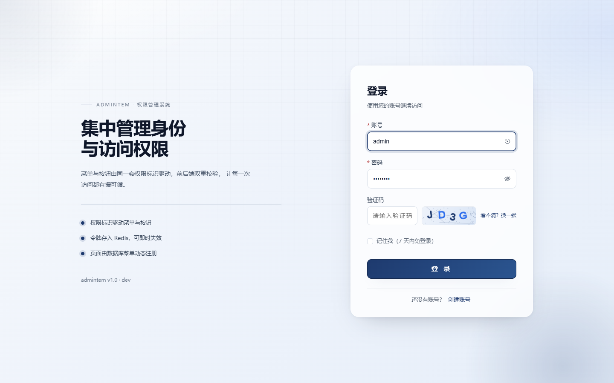
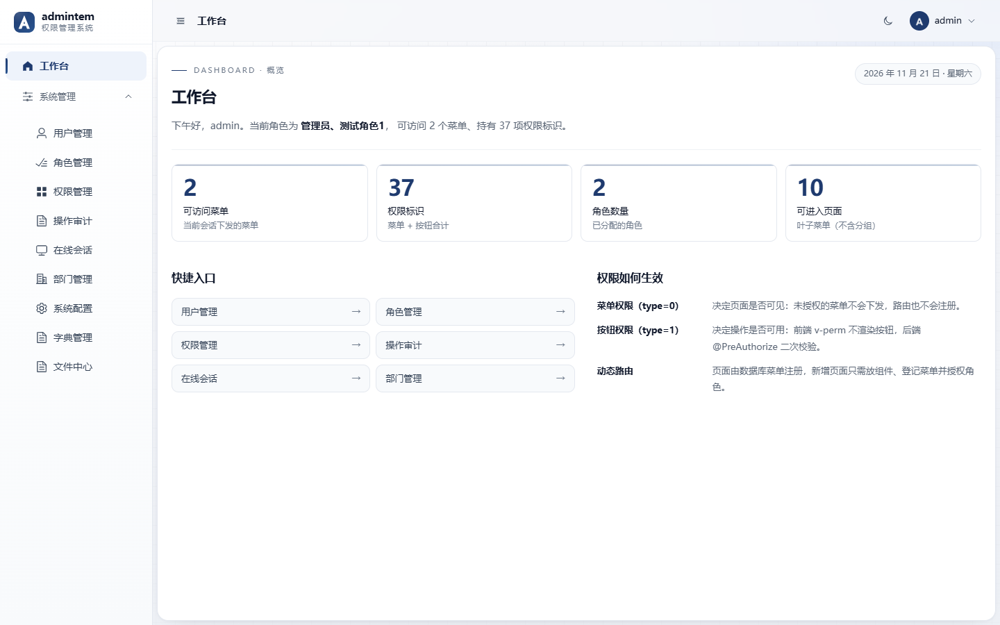
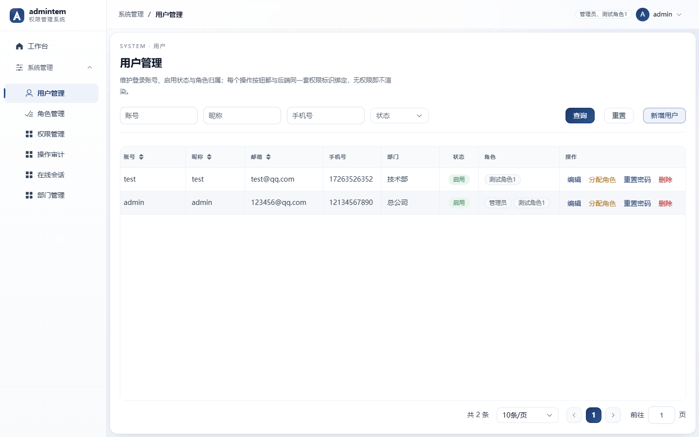
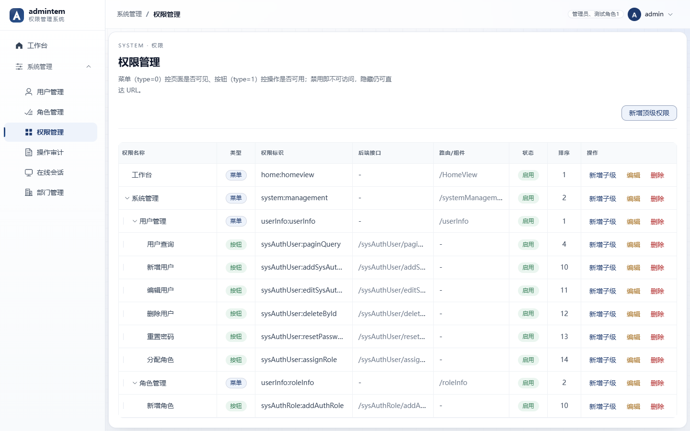
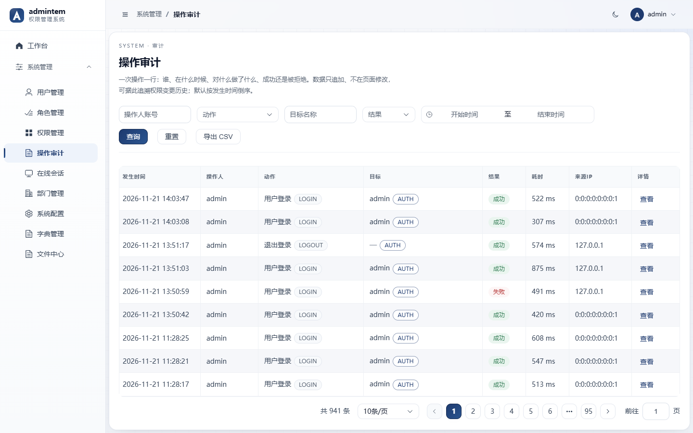
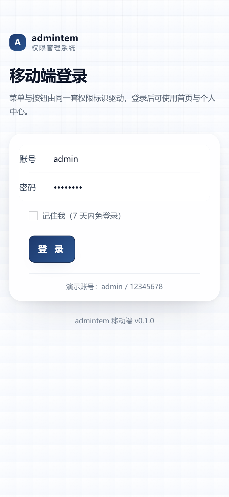

# admintem · 权限管理系统（后台管理模板）

> 一套可直接二次开发的前后端分离后台管理模板：**菜单 + 按钮级权限、动态路由、操作审计、在线会话、部门组织、头像上传**，
> 桌面端与移动端共用同一套权限标识，后端带完整迁移脚本、测试与文档。

| 项 | 值 |
| ---- | ---- |
| 后端 | Spring Boot 3.5.16 / JDK 17 / Spring Security 6 / MyBatis / MySQL 8 / Redis / Flyway |
| 桌面端 | Vue 3.5 + Vite 8 + Element Plus 2.14 + Pinia + vue-router |
| 移动端 | Vue 3.5 + Vite 8 + Vant 4（底部 Tab：首页 / 我的） |
| 默认账号 | `admin / 12345678`（管理员）、`test / 12345678`（受限账号） |
| 默认端口 | 后端 **8090**、桌面端 **5175**、Vant 移动端 **5174**、uni-app **5176**、官网模版 **5177** |

---

## 1. 它解决什么问题

大多数后台模板的"权限"只做到**菜单可见性**，按钮往往靠前端 `v-if` 写死；
换一套角色就要改代码。本项目把权限做成**数据驱动**的一条链路：

```
数据库 sys_auth_permission（菜单 + 按钮）
        │
        ├─ 登录时下发：菜单树（决定动态路由）+ permissionKeys（决定按钮）
        │
        ├─ 前端：路由由菜单动态注册；按钮由 v-perm="'xxx:yyy'" 控制
        │
        └─ 后端：同一个 key 作为 @PreAuthorize("@rbac.hasPerm('xxx:yyy')")
```

**同一个权限标识，前后端各用一次**：前端决定"看不看得见"，后端决定"调不调得通"。
即使有人绕过前端直接调接口，也会拿到 `403`。

### 已实现的功能

| 模块 | 能力 |
| ---- | ---- |
| 认证 | 登录（含"7 天免登录"）、注册（可关闭）、退出、修改密码、个人资料 |
| 用户管理 | 分页查询、新增/编辑/删除、重置密码、分配角色、**所属部门**、头像 |
| 角色管理 | 分页查询、新增/编辑/删除、分配权限（权限树） |
| 权限管理 | 菜单/按钮两级树表、增删改、父子成环保护 |
| 部门管理 | 树形部门、负责人/电话、人数统计、删除保护（有子部门或有用户时拒绝） |
| 操作审计 | 全量动作异步落库、按操作人/动作/目标/结果/时间查询、明细含 `traceId` |
| 在线会话 | 查看在线账号（剩余有效期/角色/令牌摘要）、强制下线、全部下线 |
| 安全 | JWT + Redis 白名单、登录失败锁定（账号/IP 双维度）、密码强度策略、生产密钥 fail-fast |
| 可观测 | 请求 `traceId`、慢 SQL 日志、Actuator 健康检查、结构化审计 |

---

## 2. 快速开始

### 2.1 前置条件

| 依赖 | 版本 | 说明 |
| ---- | ---- | ---- |
| JDK | 17+ | 后端编译与运行 |
| Maven | 3.9+ | 或使用 IDE 内置 |
| Node.js | 22.18+ / 24.12+ | 两端前端（Vite 8 要求） |
| MySQL | 8.0+ | 库名 `admintem_new` |
| Redis | 6+ | 令牌白名单与权限快照（**没有它后端启动失败**） |

### 2.2 初始化数据库

```bash
# 1) 建库
mysql -h<host> -u root -p -e "CREATE DATABASE admintem_new DEFAULT CHARSET utf8mb4 COLLATE utf8mb4_general_ci;"

# 2) 灌入基线（建表 + 权限 + 演示数据；脚本自带安全闸门，必须显式确认）
mysql -h<host> -u root -p
mysql> SET @admintem_confirm_reset = 1;
mysql> source admintem-docs/db/init/00_admintem_full_init.sql
```

> 初始化脚本会 **DROP 并重建** `sys_auth_*`、`sys_dept`、`sys_auth_audit_log` 等表。
> 没有 `SET @admintem_confirm_reset = 1` 会直接 `SIGNAL` 中止，不会删任何数据——这条闸门来自一次真实事故（见《09》18.6）。

后续增量变更由 Flyway 在 dev 环境自动执行 `admintem-docs/db/changelog/V*.sql`（已应用到 V1.0.10）。

### 2.3 配置连接信息

真实口令**不入库**，放在本地文件 `admintem-backend/config/application-local.yml`（已在 `.gitignore`）：

```yaml
# 通过环境变量占位符注入，application.yml 里用 spring.config.import 加载
ADMINTEM_DB_PASSWORD: "你的数据库密码"
ADMINTEM_REDIS_PASSWORD: "你的Redis密码"
```

数据库地址/账号在 `application-{dev,test,pre,pro}.yml` 中，默认指向本机或内网 MySQL。

### 2.4 启动

```bash
# 后端（默认 dev profile）
cd admintem-backend
mvn clean package -DskipTests
java -jar target/admintem-backend.jar

# 桌面端
cd admintem-vue
npm install
npm run dev -- --port 5175 --strictPort

# 移动端
cd admintem-mobile
npm install
npm run dev -- --port 5174 --strictPort
```

| 入口 | 地址 |
| ---- | ---- |
| 桌面端 | http://localhost:5175 |
| 移动端（Vant） | http://localhost:5174/#/login |
| uni-app（H5） | http://localhost:5176 |
| 接口文档 | http://localhost:8090/swagger-ui/index.html |
| 健康检查 | http://localhost:8090/actuator/health |

> Swagger 调试时点右上角 **Authorize**，填入 `LAUNCH <登录返回的 token>`。
> 令牌请求头名默认 `admintem_token`（可在 `admintem.jwt.header` 修改）。

> 文件存储默认本地（`admintem-backend/uploads/avatar`）；切 MinIO 设置
> `admintem.storage.type=minio`，密钥放 `config/application-local.yml`，详见《14-文件存储策略与MinIO接入》。

---

## 3. 权限模型

### 3.1 五张核心表

| 表 | 作用 | 关键词 |
| ---- | ---- | ---- |
| `sys_auth_user` | 用户 | `user_name`、`status`、`is_deleted`、`dept_id` |
| `sys_auth_role` | 角色 | `role_key`（`admin` 为超管标识） |
| `sys_auth_permission` | 权限（菜单 + 按钮） | `type`（0 菜单 / 1 按钮）、`permission_key`、`menu_url`、`component`、`show` |
| `sys_auth_user_role` | 用户-角色 | — |
| `sys_auth_role_permission` | 角色-权限 | — |

另有 `sys_dept`（部门树）、`sys_auth_audit_log`（审计，只追加）。

### 3.2 三条口径（很容易踩错）

1. **超管旁路的是接口，不是菜单**：`admin` 对 `@PreAuthorize` 有旁路，
   但菜单可见性仍需要 `sys_auth_role_permission` 里有授权行——否则"接口能调、菜单看不见"。
2. **`status` 与 `show` 都生效**：`status=1`（禁用）不下发、不可访问；
   `show=1`（隐藏）仍可 URL 直达，只是不出现在导航里。
3. **删除是逻辑删除**：`is_deleted=1`；唯一性靠函数索引
   `UNIQUE KEY ((IF(is_deleted=0, 业务键, NULL)))`，因此"删除后可同名重建"。

### 3.3 新增一个受控功能的标准动作

```text
1) 菜单：插 sys_auth_permission(type=0, component='xxx/index', permission_key='xxx:xxx')
2) 按钮：插 type=1 的子行（如 sysXxx:addXxx）
3) 授权：给需要的角色插 sys_auth_role_permission
4) 前端：views/xxx/index.vue + v-perm="'sysXxx:addXxx'"
5) 后端：@PreAuthorize("@rbac.hasPerm('sysXxx:addXxx')")
6) 文档：更新《05》并执行 node admintem-docs/tests/gen-role-endpoint-matrix.cjs
```

---

## 4. 目录结构

```text
admin-template/
├── admintem-backend/            Spring Boot 后端
│   ├── config/                  本地口令覆盖（不入库）
│   ├── src/main/java/com/admintem/web/
│   │   ├── config/              属性、安全、MyBatis、Redis、Swagger、上传映射
│   │   ├── security/            JWT、RBAC、登录风控、密码策略
│   │   ├── controller/          7 个控制器（认证/用户/角色/权限/审计/会话/部门）
│   │   ├── service(+impl)/      业务与事务边界
│   │   ├── mapper/ + resources/mapper/*.xml   SQL 全部在 XML
│   │   ├── entity(.dto/.vo)/    实体、入参、出参
│   │   └── aspect/ filter/ util/ common/ exception/
│   └── src/test/java/           144 个单元测试
├── admintem-vue/                桌面端（Element Plus）
├── admintem-mobile/             移动端（Vant 4）
├── admintem-uniapp/             uni-app 客户端（H5 + 微信小程序，共用后端）\n├── admintem-site/               通用官网模版（Vue 3 + Tailwind + anime.js）
└── admintem-docs/               设计与操作文档 + 测试脚本
    ├── 01~16 号文档（13 移动端组件库、14 文件存储、15 方法日志、16 Jenkins 部署）
    ├── db/init + db/changelog   建库脚本与增量迁移（唯一出处）
    ├── images/                  21 张页面截图（交付物，入库）
    └── tests/                   5 个检查器 + 接口回归 + 两端 E2E + 截图脚本
```

---

## 5. 质量门禁（全部可本地跑）

```bash
# 后端单测（144）
cd admintem-backend && mvn test

# 接口回归（78 项，需后端已启动）
powershell -File admintem-docs/tests/api-regression-test.ps1

# 桌面端 E2E（21 项）/ 移动端 E2E（41 项）
node admintem-docs/tests/e2e-admin-login.cjs
node admintem-docs/tests/e2e-mobile-login.cjs

# 设计层与文档一致性
node admintem-docs/tests/check-design-a11y.cjs      # 123 项
node admintem-docs/tests/check-tokens.cjs           # 设计令牌
node admintem-docs/tests/check-perm-keys.cjs        # 前端权限标识都已在库中定义
node admintem-docs/tests/check-permission-doc-consistency.cjs
node admintem-docs/tests/check-doc-images.cjs
node admintem-docs/tests/gen-role-endpoint-matrix.cjs --check

# 前端
cd admintem-vue && npm run lint && npm test && npm run build
cd admintem-mobile && npm run build
cd admintem-uniapp && pnpm build:h5 && pnpm build:mp-weixin
```

当前基线：**144 单测 / 78 接口 / 21 桌面 E2E / 41 移动 E2E / 123 设计层 / 10 前端单测 / 0 lint 告警**，
权限 26 条、受控接口 26 个、矩阵与文档检查器全绿。

---

## 6. 设计说明（为什么这样写）

代码里刻意保留了大量中文注释，重点解释**取舍**而不是复述语法。几条典型：

| 决策 | 原因（详见文档） |
| ---- | ---- |
| SQL 全部写在 XML | 便于审阅与调优；不在 Java 里拼 SQL |
| 令牌用 Redis 白名单 | 支持"立即失效"（退出、强制下线、改密），纯 JWT 做不到 |
| 在线会话不建表 | 白名单本身就是在线事实来源，避免两处状态不一致 |
| 审计异步落库 | 审计是附加动作，不能拖慢主流程；队列满时回退同步（CallerRuns） |
| 头像存储可切换 | 工厂 + 策略：默认本地目录，`admintem.storage.type=minio` 即切对象存储；接口与前端不变 |
| 部门不参与授权 | 组织维度 ≠ 授权维度；按部门过滤数据属于 ABAC，另立项 |
| 唯一索引用函数索引 | 逻辑删除下实现"未删除行唯一 + 删除后可同名重建" |

---

## 6.1 设计系统 V2（浅色）

界面语言是**层叠纸面 + 克制玻璃**：纸面有极淡渐变与网格，卡片 1px 细边 + 三层投影，
主按钮深蓝渐变、表格表头用次级面，鼠标悬停只"浮起 2px"而不改变尺寸。

| 维度 | 取值 |
| ---- | ---- |
| 色彩 | 纸面 `#f6f7fa` / 卡片 `#fff` / 主色 `#1e3a6e`（渐变端 `#14294f`）/ 墨色 slate `#0f172a…` |
| 字体 | 系统 UI 栈（Segoe UI / 苹方 / 雅黑），零网络依赖 |
| 圆角 | 控件 10px、卡片 16px、标签与分页胶囊 999px |
| 投影 | `--lc-shadow-card` / `--lc-shadow-float` / `--lc-shadow-sheet`，**整值使用** |
| 动效 | anime.js v4：外壳错峰入场、路由淡入、登录页 blur-fade、工作台数字滚动、表格行入场 |
| 可访问性 | 键盘焦点环 2px、`prefers-reduced-motion` 全短路、对比度 18 组 × 2 端全部 ≥ 门槛 |

品牌资产：`admintem-vue/public/favicon.svg`（移动端同文件），同时用于浏览器标签页、侧边栏与移动端登录页标记。

参考：`ui-ux-pro-max` 的浅色设计系统、shadcn/ui 的语义令牌结构、Magic UI 的指针柔光/数字滚动、
anime.js v4 的时间线编排。**均为设计手法借鉴，运行时不依赖 React / Tailwind / Radix。**

细节见《02-系统设计文档》12.6.1 与《09》第 30 节。

## 7. 文档导航

| 文档 | 内容 |
| ---- | ---- |
| [01-需求与范围](admintem-docs/01-需求与范围.md) | 目标、边界、角色 |
| [02-系统设计文档](admintem-docs/02-系统设计文档.md) | 架构、鉴权链路、缓存、审计、上传、部门 |
| [03-数据库设计与变更说明](admintem-docs/03-数据库设计与变更说明.md) | 表结构 + V1.0.1~V1.0.10 变更（含回滚） |
| [04-部署与操作手册](admintem-docs/04-部署与操作手册.md) | 环境、配置项、启动、故障处理 |
| [05-接口与权限标识对照表](admintem-docs/05-接口与权限标识对照表.md) | 每个接口对应的权限标识（含自动生成的矩阵） |
| [06-测试报告](admintem-docs/06-测试报告.md) | 每轮验证的实测数据 |
| [07-维护与文档同步约定](admintem-docs/07-维护与文档同步约定.md) | 改代码必须同步哪些文档/脚本 |
| [08-权限动态认证设计与原项目对比](admintem-docs/08-权限动态认证设计与原项目对比.md) | 与旧项目实现的差异与改进 |
| [09-代码审计与质量记录](admintem-docs/09-代码审计与质量记录.md) | 每次优化的动机、踩坑与修复（含事故复盘） |
| [10-后续功能扩展规划](admintem-docs/10-后续功能扩展规划.md) | 可继续做的方向 |
| [11-优化任务清单与时间窗计划](admintem-docs/11-优化任务清单与时间窗计划.md) | 批次记录与验收口径 |
| [12-页面与界面说明](admintem-docs/12-页面与界面说明.md) | 每个页面的字段、按钮、权限、截图 |

---

## 8. 界面预览

| 登录 | 工作台 | 用户管理 |
| ---- | ---- | ---- |
|  |  |  |

| 权限树 | 操作审计 | 移动端 |
| ---- | ---- | ---- |
|  |  |  |

更多截图见 `admintem-docs/images/`（21 张，含角色授权、部门、在线会话、审计明细、移动端三页）。

---

## 9. 环境与部署

| 环境 | Profile | 说明 |
| ---- | ---- | ---- |
| 开发 | `dev`（默认） | Flyway 自动迁移、SQL 全量日志、CORS 放开 |
| 测试 | `test` | 与 dev 共用库，便于联调 |
| 预发 | `pre` | 关闭 SQL 明细日志 |
| 生产 | `pro` | 关闭 Flyway、强制 `fail-on-default-secret`、关闭 Swagger 明细 |

```bash
# 生产打包示例
mvn -P pro clean package -DskipTests
java -jar target/admintem-backend.jar --spring.profiles.active=pro
```

Docker：`admintem-backend/Dockerfile` 为多阶段构建、非 root 运行、带 `HEALTHCHECK`；
CI 见 `.github/workflows/ci.yml`（后端单测 + 两端构建 + 文档检查）与 `e2e-nightly.yml`。

---

## 10. 约定

- **注释与文档使用中文**，解释"为什么"，而不是重复代码。
- 提交信息使用中文，按 `feat/fix/refactor/docs/chore` 前缀 + 要点列表。
- 每完成一个功能：**改代码 → 跑门禁 → 更新文档 → 单独提交**。
- 前端样式统一走设计令牌：`--lc-*`（`lc` 是设计系统命名空间，项目改名时刻意保留，避免大规模无意义改动）。
- 数据库变更只允许**新增** `V1.0.x__xxx.sql`，必须幂等、写明影响面与回滚方式。

---

## 11. 后续可做

- 数据权限（本人 / 本部门 / 全部）—— 需要改每条查询的 `WHERE`，建议单独立项
- 令牌续期（refresh token）与并发登录策略
- 用户/审计导出 Excel、批量操作
- 审计归档定时任务、趋势图表
- 前端组件测试、`@WebMvcTest` 切片测试

---

## 12. 许可

内部模板工程，默认仅限授权范围内使用；如需开源请补充 `LICENSE` 并确认第三方依赖许可。
