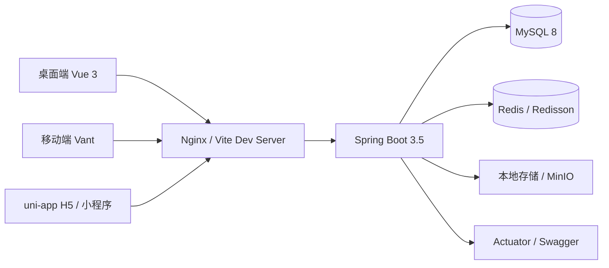

<h1 align="center">admintem</h1>

<p align="center">
  <strong>菜单 + 按钮级权限的一体化后台管理模板</strong><br />
  桌面端 / 移动端 / uni-app 共用一套权限标识，后端提供完整迁移脚本、测试与文档。
</p>

<p align="center">
  <a href="https://github.com/lw24-1936/admin-template/actions/workflows/ci.yml">
    
  </a>
  <a href="https://github.com/lw24-1936/admin-template/actions/workflows/e2e-nightly.yml">
    
  </a>
  <a href="LICENSE">
    
  </a>
  
  
  
  
</p>

> **默认账号**：`admin / 12345678`（管理员）、`test / 12345678`（受限账号）。
> 首次部署后请立即修改默认密码，并替换生产环境的 JWT 密钥。

---

## 目录

- [核心能力](#核心能力)
- [界面预览](#界面预览)
- [技术栈](#技术栈)
- [系统架构](#系统架构)
- [权限模型](#权限模型)
- [快速开始](#快速开始)
- [质量门禁](#质量门禁)
- [部署](#部署)
- [目录结构](#目录结构)
- [文档](#文档)
- [安全与约定](#安全与约定)
- [后续规划](#后续规划)
- [许可](#许可)

## 核心能力

| 模块 | 能力 |
| ---- | ---- |
| 认证 | 登录（7 天免登录）、refreshToken 轮换、注册（可关闭）、退出、修改密码、个人资料、头像上传 |
| 用户管理 | 分页查询、新增/编辑/删除、重置密码、分配角色、所属部门、头像、CSV 导入/导出 |
| 角色管理 | 分页查询、新增/编辑/删除、权限树授权、行级数据范围（全部/本部门/本部门及子部门/本人） |
| 权限管理 | 菜单/按钮两级树表、增删改、父子成环保护 |
| 部门管理 | 树形部门、负责人/电话、人数统计、删除保护（有子部门或用户时拒绝） |
| 系统参数 | 键值配置 CRUD、分组、键唯一、逻辑删除、操作审计；可作为开关/上传限制等统一配置中心 |
| 数据字典 | 字典类型/文案/值/排序/状态，同类型值唯一；提供按类型读取启用项的接口 |
| 文件中心 | 通用附件上传、列表、逻辑删除；扩展名/大小白名单；本地与 MinIO 共用存储策略 |
| 操作审计 | 异步落库、按操作人/动作/目标/结果/时间查询、明细含 `traceId` |
| 在线会话 | 查看在线账号、剩余有效期、角色、令牌摘要；强制下线、全部下线 |
| 安全 | JWT + Redis 白名单、登录失败锁定（账号/IP 双维度）、密码强度策略、生产密钥 fail-fast |
| 可观测 | 请求 `traceId`、慢 SQL 日志、Actuator 健康检查、结构化审计 |

**当前基线**：后端 162 项单测、78 项接口回归、桌面 21 项 E2E、移动 44 项 E2E、
123 项设计层断言、前端 10 + 6 项单测；权限 37 条、受控接口 40 个，CI 全绿。

## 界面预览

| 登录 | 工作台 | 用户管理 |
| :--: | :--: | :--: |
|  |  |  |

| 角色授权 | 操作审计 | 移动端「我的」 |
| :--: | :--: | :--: |
|  |  |  |

更多页面（权限树、部门、在线会话、审计明细、403/404、移动端登录/首页/改密）见
[`admintem-docs/images/`](admintem-docs/images/)，每张截图都有对应页面说明。

## 技术栈

| 层 | 技术 |
| ---- | ---- |
| 后端 | Spring Boot 3.5.16 · JDK 17 · Spring Security 6 · MyBatis-Plus 3.5.17 · MySQL 8 · Redis / Redisson · Flyway · springdoc-openapi |
| 桌面端 | Vue 3.5 · Vite 8 · Element Plus 2.14 · Pinia · Vue Router · anime.js v4 |
| 移动端 | Vue 3.5 · Vite 8 · Vant 4（底部 Tab） |
| uni-app | Vue 3 · uni-app 3 · pnpm（H5 / 微信小程序 / App 资源包） |
| 官网模版 | Vue 3 · Vite 5（可选） |
| 测试 | JUnit 5 / Mockito · node:test · Playwright（桌面 + 移动）· PowerShell 接口回归 |

## 系统架构



- **认证**：登录签发 JWT，同时写入 Redis 白名单；退出、强制下线、改密都会立即吊销。
- **授权**：菜单树决定动态路由，`permission_keys` 决定按钮；接口侧使用同一 key 的 `@PreAuthorize`。
- **审计**：AOP 异步写入审计表；队列满时回退同步（CallerRuns），不丢审计。
- **上传**：`FileStorageFactory` + 策略模式；默认本地目录，配置 `admintem.storage.type=minio` 切换对象存储，接口和前端不变。

## 权限模型

```text
sys_auth_permission（菜单 + 按钮）
        │
        ├─ 登录下发菜单树 → 前端动态注册路由
        ├─ 登录下发 permissionKeys → v-perm="'sysXxx:addXxx'"
        └─ 同一 key → @PreAuthorize("@rbac.hasPerm('sysXxx:addXxx')")
```

三条容易踩错的约定：

1. **超管旁路的是接口，不是菜单**：`admin` 能调受控接口，但菜单仍需要角色授权行，否则会出现“接口能调、菜单看不见”。
2. **`status` 与 `show` 都生效**：`status=1` 不下发、不可访问；`show=1` 隐藏但仍可通过 URL 直达，只是不出现在导航里。
3. **删除是逻辑删除**：`is_deleted=1`，唯一性用函数索引保证“未删除行唯一、删除后可同名重建”。

完整表结构与鉴权链路见 [02-系统设计文档](admintem-docs/02-系统设计文档.md)、
[03-数据库设计与变更说明](admintem-docs/03-数据库设计与变更说明.md) 和
[05-接口与权限标识对照表](admintem-docs/05-接口与权限标识对照表.md)。

## 快速开始

### 前置条件

| 依赖 | 版本 | 说明 |
| ---- | ---- | ---- |
| JDK | 17+ | 后端编译与运行 |
| Maven | 3.9+ | 或使用 IDE 内置 |
| Node.js | 22 LTS（推荐） | 桌面端要求 `^22.18 || >=24.12`；移动端 `>=20.19` |
| MySQL | 8.0+ | 默认库名 `admintem_new` |
| Redis | 6+ | 令牌白名单与权限快照；**没有它后端会启动失败** |
| pnpm | 10（可选） | 仅 uni-app 需要 |

### 0. 一键启动（推荐）

```bash
cp .env.example .env       # Windows: copy .env.example .env
docker compose up -d --build
```

启动完成后直接访问 <http://localhost:5175>（桌面端）或 <http://localhost:5174>（移动端）。
Compose 会创建 MySQL/Redis、初始化数据库、构建后端与两端前端；详细配置见 `.env.example`。
停止：`docker compose down`；清空本地数据并重建：`make db-reset`（或 `docker compose down -v`）。

### 1. 获取代码

```bash
git clone https://github.com/lw24-1936/admin-template.git
cd admin-template
```

国内网络也可使用 Gitee 镜像：`https://gitee.com/liuwei9599/admin-template.git`。

### 2. 初始化数据库

```bash
# 建库
mysql -h127.0.0.1 -uroot -p \
  -e "CREATE DATABASE admintem_new DEFAULT CHARSET utf8mb4 COLLATE utf8mb4_general_ci;"

# 进入 mysql 后执行（脚本会 DROP 并重建业务表，必须显式确认）
mysql -h127.0.0.1 -uroot -p
mysql> SET @admintem_confirm_reset = 1;
mysql> source admintem-docs/db/init/00_admintem_full_init.sql
```

自动化环境可改用 stdin（与 CI 一致，避免 `source` 在 `-e` 中被当成 SQL）：

```bash
{ echo 'SET @admintem_confirm_reset = 1;'; cat admintem-docs/db/init/00_admintem_full_init.sql; } \
  | mysql -h127.0.0.1 -uroot -p --default-character-set=utf8mb4
```

> 没有 `SET @admintem_confirm_reset = 1` 时脚本会 `SIGNAL` 中止，不会删除任何数据。
> 后续增量迁移由 Flyway 执行 `admintem-docs/db/changelog/V*.sql`（当前到 V1.0.14）。
> 全量 init 负责基础表/种子，**不预置后续迁移新增的列**（如 `data_scope`）；首次初始化后
> 启动后端（或执行 Flyway migrate）补齐，才能得到完整结构。

### 3. 配置本地口令

敏感配置不进入版本库。复制示例并按实际环境填写：

```bash
cp admintem-backend/config/application-local.yml.example \
   admintem-backend/config/application-local.yml
```

```yaml
ADMINTEM_DB_HOST: "127.0.0.1"
ADMINTEM_DB_PORT: "3306"
ADMINTEM_DB_NAME: "admintem_new"
ADMINTEM_DB_USERNAME: "admintem"
ADMINTEM_DB_PASSWORD: "你的 MySQL 密码"

ADMINTEM_REDIS_HOST: "127.0.0.1"
ADMINTEM_REDIS_PORT: "6379"
ADMINTEM_REDIS_DATABASE: "0"
ADMINTEM_REDIS_PASSWORD: "你的 Redis 密码"
```

`application.yml` 通过 `spring.config.import: optional:file:./config/application-local.yml`
自动加载；也可以直接用同名环境变量注入（容器/CI 推荐）。生产环境不要使用 `root`，
应创建只拥有 `admintem_new` 库权限的应用账号。

### 4. 启动后端

```bash
cd admintem-backend
mvn clean package -DskipTests
java -jar target/admintem-backend.jar
```

默认 `dev` profile，端口 **8090**。健康检查：<http://localhost:8090/actuator/health>；
接口文档：<http://localhost:8090/swagger-ui/index.html>（Authorize 填 `LAUNCH <token>`）。

### 5. 启动前端

```bash
# 桌面端（默认 5175）
cd admintem-vue
npm install
npm run dev

# 移动端（默认 5174）
cd admintem-mobile
npm install
npm run dev
```

可选：

```bash
# uni-app H5 / 微信小程序（pnpm）
cd admintem-uniapp
pnpm install
pnpm dev:h5          # http://localhost:5176

# 官网模版
cd admintem-site
npm install
npm run dev          # http://localhost:5177
```

| 入口 | 地址 |
| ---- | ---- |
| 桌面端 | <http://localhost:5175> |
| 移动端（Vant） | <http://localhost:5174/#/login> |
| uni-app（H5） | <http://localhost:5176> |
| 官网模版 | <http://localhost:5177> |
| 后端健康检查 | <http://localhost:8090/actuator/health> |
| Swagger | <http://localhost:8090/swagger-ui/index.html> |

## 质量门禁

```bash
# 后端单测（159 项）
cd admintem-backend && mvn test

# 接口回归（78 项；需后端已启动）
pwsh -NoProfile -File admintem-docs/tests/api-regression-test.ps1 -BaseUrl http://localhost:8090

# 桌面 E2E（21 项）/ 移动 E2E（44 项）；需后端 + 两端 dev server
node admintem-docs/tests/e2e-admin-login.cjs
node admintem-docs/tests/e2e-mobile-login.cjs

# 设计层与文档一致性
node admintem-docs/tests/check-design-a11y.cjs      # 123 项，需两端服务
node admintem-docs/tests/check-tokens.cjs
node admintem-docs/tests/check-perm-keys.cjs
node admintem-docs/tests/check-permission-doc-consistency.cjs
node admintem-docs/tests/check-doc-images.cjs
node admintem-docs/tests/gen-role-endpoint-matrix.cjs --check

# 前端
cd admintem-vue && npm run lint && npm test && npm run build
cd admintem-mobile && npm run build && npm test
cd admintem-uniapp && pnpm lint && pnpm build:h5 && pnpm build:mp-weixin
```

CI 分两层：

- [`ci.yml`](.github/workflows/ci.yml)：每次 push / PR，跑后端单测、两端构建与单测、5 个文档/设计检查器、uni-app 三端构建。
- [`e2e-nightly.yml`](.github/workflows/e2e-nightly.yml)：每天 UTC 18:00（北京时间次日 02:00）拉起 MySQL/Redis，跑 78 项接口回归和两端真实浏览器 E2E；也可在 Actions 页面手动触发。

## 部署

### Docker

```bash
# 构建上下文必须是仓库根（Dockerfile 需要 admintem-docs/db/changelog）
docker build -f admintem-backend/Dockerfile -t admintem-backend:1.0.0 .

docker run -p 8090:8090 \
  --env-file .env \
  -v "$PWD/uploads:/app/uploads" \
  admintem-backend:1.0.0
```

`.env` 至少包含 `ADMINTEM_DB_PASSWORD` 与 `ADMINTEM_REDIS_PASSWORD`；镜像以非 root 用户运行，
带 Actuator `HEALTHCHECK`。

### 生产 Profile

```bash
cd admintem-backend
mvn -P pro clean package -DskipTests
java -jar target/admintem-backend.jar --spring.profiles.active=pro
```

生产环境会关闭 Flyway 自动迁移与 Swagger 明细，强制校验 JWT 密钥，并要求 CORS 来源显式配置。
Nginx、Jenkins 自由风格任务与完整操作步骤见 [04-部署与操作手册](admintem-docs/04-部署与操作手册.md)
和 [16-Jenkins 自由风格部署教程](admintem-docs/16-Jenkins自由风格部署教程.md)。

## 目录结构

```text
admin-template/
├── admintem-backend/            Spring Boot 后端
│   ├── config/                  本地口令示例（真实文件已 gitignore）
│   ├── src/main/java/...        9 个控制器、service、mapper、security、aspect
│   ├── src/main/resources/      application*.yml、mapper XML
│   ├── src/test/java/           162 个单元测试
│   └── Dockerfile               多阶段构建、非 root、HEALTHCHECK
├── admintem-vue/                桌面端（Element Plus）
├── admintem-mobile/             移动端（Vant 4）
├── admintem-uniapp/             uni-app（H5 / 微信小程序 / App 资源包）
├── admintem-site/               官网模版（可选）
├── admintem-docs/               01~16 号文档、SQL、截图与测试脚本
│   ├── db/init/                 基础结构+种子（迁移新增列由 Flyway 管理）
│   ├── db/changelog/            Flyway V1.0.1 ~ V1.0.14
│   ├── images/                  21 张页面截图
│   └── tests/                   接口回归、两端 E2E、检查器、截图脚本
└── .github/workflows/           CI 与 nightly E2E
```

## 文档

| 文档 | 内容 |
| ---- | ---- |
| [01-需求与范围](admintem-docs/01-需求与范围.md) | 目标、边界、角色 |
| [02-系统设计文档](admintem-docs/02-系统设计文档.md) | 架构、鉴权链路、缓存、审计、上传、部门 |
| [03-数据库设计与变更说明](admintem-docs/03-数据库设计与变更说明.md) | 表结构 + V1.0.1~V1.0.14 变更与回滚 |
| [AGENTS.md](AGENTS.md) | 给 AI/自动化代理的项目约定、命令、权限/迁移/测试/文档同步规则 |
| [04-部署与操作手册](admintem-docs/04-部署与操作手册.md) | 环境、配置、启动、故障处理 |
| [05-接口与权限标识对照表](admintem-docs/05-接口与权限标识对照表.md) | 接口与权限标识矩阵 |
| [06-测试报告](admintem-docs/06-测试报告.md) | 各轮验证的实测数据 |
| [07-维护与文档同步约定](admintem-docs/07-维护与文档同步约定.md) | 改代码必须同步哪些文档/脚本 |
| [08-权限动态认证设计与原项目对比](admintem-docs/08-权限动态认证设计与原项目对比.md) | 与旧项目实现的差异 |
| [09-代码审计与质量记录](admintem-docs/09-代码审计与质量记录.md) | 优化动机、踩坑与事故复盘 |
| [10-后续功能扩展规划](admintem-docs/10-后续功能扩展规划.md) | 可继续做的方向 |
| [11-优化任务清单与时间窗计划](admintem-docs/11-优化任务清单与时间窗计划.md) | 批次记录与验收口径 |
| [12-页面与界面说明](admintem-docs/12-页面与界面说明.md) | 每个页面的字段、按钮、权限、截图 |
| [13-移动端组件库使用约定](admintem-docs/13-移动端组件库使用约定.md) | Vant 使用约定与页面模式 |
| [14-文件存储策略与 MinIO 接入](admintem-docs/14-文件存储策略与MinIO接入.md) | 本地/MinIO 策略与切换 |
| [15-后端方法日志规范](admintem-docs/15-后端方法日志规范.md) | 方法日志字段与脱敏 |
| [16-Jenkins 自由风格部署教程](admintem-docs/16-Jenkins自由风格部署教程.md) | Jenkins 部署全流程 |

文档索引见 [`admintem-docs/README.md`](admintem-docs/README.md)。

## 安全与约定

- **默认账号仅用于演示**：上线前修改 `admin` / `test` 密码，删除无用测试账号。
- **生产密钥必须替换**：`admintem.jwt.secret` 不能沿用示例值；`pro` profile 会拒绝含 `change-me` 的密钥。
- **敏感配置不入库**：数据库/Redis/MinIO 口令放 `config/application-local.yml` 或容器 Secret。
- **上传可切换存储**：默认本地目录，生产建议 MinIO/S3，并持久化 `uploads` 或对象桶。
- **中文注释与文档**：解释“为什么”而不是复述代码；提交信息使用 `feat/fix/refactor/docs/chore` 前缀。
- **数据库变更只新增** `V1.0.x__xxx.sql`：幂等、写明影响面与回滚方式，不修改历史脚本。
- **样式统一走设计令牌**：`--lc-*`；改页面必须同步检查 `check-tokens.cjs` 与文档截图。

## 后续规划

- ~~数据权限（本人 / 本部门 / 全部）~~（已落地：角色 `data_scope`）
- 令牌续期（refresh token）与并发登录策略
- 用户/审计导出 Excel、批量操作
- 审计归档定时任务、趋势图表
- 前端组件测试与 `@WebMvcTest` 切片测试

欢迎通过 Issue / Pull Request 提交改进；新增功能请同时更新对应文档与测试基线。

## 许可

本项目基于 [Apache License 2.0](LICENSE) 开源。

第三方依赖遵循各自许可；设计参考（shadcn/ui 语义令牌、Magic UI 柔光、anime.js 动效）均为设计手法借鉴，
运行时**不依赖 React / Tailwind / Radix**。
