# 12-页面与界面说明（含全部页面截图）

> 本文是系统的**界面说明书**：逐页给出访问路径、入口、截图与操作说明，
> 并标注该页面/按钮背后的 `permission_key`，便于对照《05-接口与权限标识对照表》理解权限效果。
>
> 截图由脚本自动生成，请勿手工替换：
> `cd admintem-docs/tests && node capture-screenshots.cjs`（需后端 8090 + 桌面端 5173 + 移动端 5174 已启动）。
> 界面改动后应重新执行一次，保持文档与代码同步（见《07-维护与文档同步约定》）。
>
> **截图版本**：本页 19 张截图已随 E 组界面改版（纸面极简 · 编辑式）重拍；
> 视觉语言与设计 token 的取值见《02-系统设计文档》第 12 节。

**截图环境**：桌面端 1440×900（Edge），移动端 390×844（移动模拟、2 倍像素密度）；
数据为演示基线：2 个账号（`admin`、`test`）、3 个角色、18 条菜单/按钮权限。

---

## 一、桌面端

### 1.1 登录页

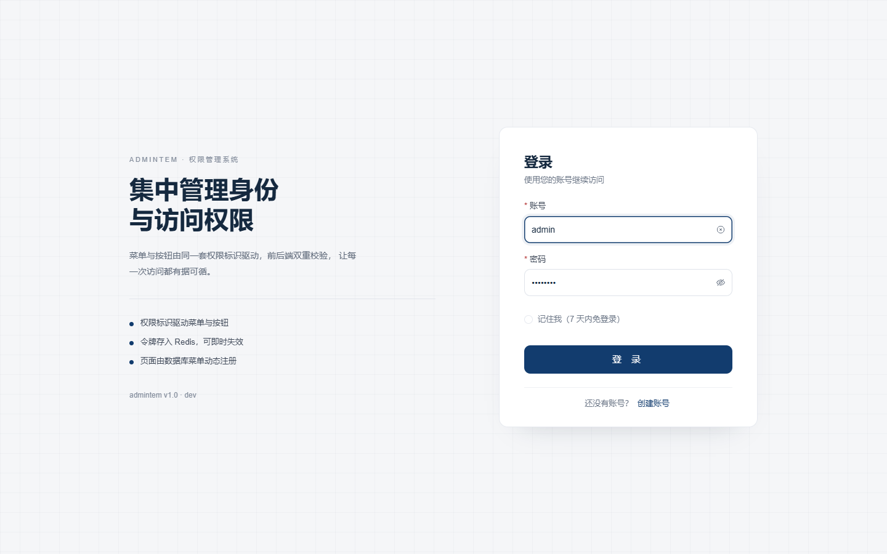

| 项 | 说明 |
| ---- | ---- |
| 路径 | `/login`（免登录白名单） |
| 入口 | 直接访问；未登录访问任何受保护页面也会被守卫重定向到此，并带 `redirect` 参数 |
| 操作 | 输入账号密码 → 勾选「记住我（7 天内免登录）」可延长令牌有效期 → 点击「登 录」 |
| 视觉 | 纸面极简排版：左侧编辑式品牌文案、右侧白卡片表单；无渐变与光效 |
| 失败反馈 | 账号或密码错误返回业务码 501；连续失败 5 次锁定 10 分钟（返回 502） |

### 1.2 注册页

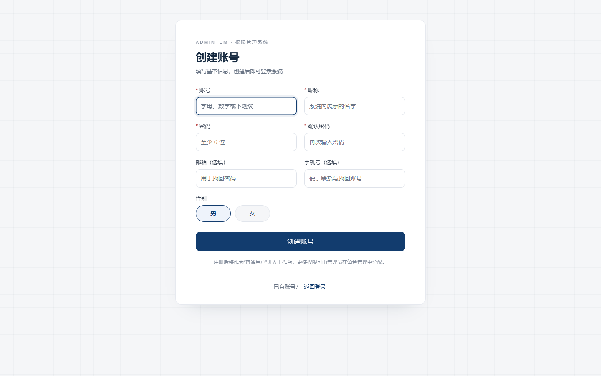

| 项 | 说明 |
| ---- | ---- |
| 路径 | `/register`（免登录白名单） |
| 操作 | 填写账号、昵称、密码、邮箱、手机号等字段 → 提交 |
| 结果 | 注册成功即自动分配默认角色 `common`（默认仅「工作台」菜单） |
| 开关 | 生产环境默认关闭自助注册（`admintem.auth.register-enabled=false`），此时接口返回业务码 506 |

### 1.3 工作台（首页）

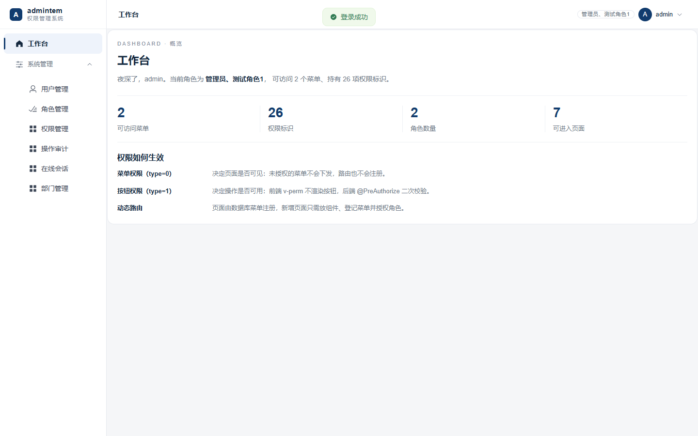

| 项 | 说明 |
| ---- | ---- |
| 路径 | `/HomeView`（登录后默认进入的第一个可访问菜单） |
| 权限 | 菜单标识 `home:homeview` |
| 内容 | 欢迎语与当前角色、可访问范围概览 |
| 说明 | 左侧导航与顶部面包屑均来自后端下发的菜单树（数据库驱动） |
| 视觉 | 编辑式信息卡：小标签 + 标题 + 一段导语，下方四列数据条（当前角色 / 可见菜单 / 权限标识 / 账号），仅用竖向细线分隔，不再堆卡片、不再使用蓝色提示框；末尾以三条口径说明讲清「菜单权限 / 按钮权限 / 动态路由」如何生效 |

### 1.4 用户管理

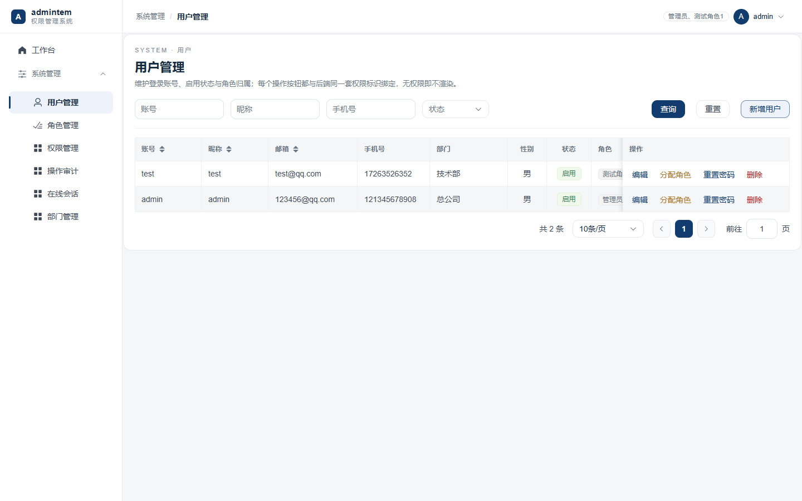

| 项 | 说明 |
| ---- | ---- |
| 路径 | `/userInfo` |
| 权限 | 菜单标识 `userInfo:userInfo` |
| 列表 | 账号、昵称、邮箱、手机号、性别、状态、角色、创建时间；支持按账号/昵称/手机号模糊查询与状态过滤 |
| 排序 | 账号、昵称、邮箱、创建时间列头可排序（`sortField/sortOrder` 经后端白名单映射，未登记字段被忽略） |
| 分页 | 默认每页 10 条，单页上限 500 |
| 视觉 | 统一表格语言：表头 12px + 字距 0.4px 的次要墨色、行高 44、只保留横向细线、数字等宽；工具栏为「小标签 + 标题 + 口径说明」加右侧筛选/操作区；空表显示纸面空状态，加载为纸面遮罩 + 主色指示器 |
| 按钮权限 | 见下表（无权限的按钮**不会渲染**） |

| 操作按钮 | permission_key |
| ---- | ---- |
| 新增用户 | `sysAuthUser:addSysAuthUser` |
| 编辑 | `sysAuthUser:editSysAuthUser` |
| 分配角色 | `sysAuthUser:assignRole` |
| 重置密码 | `sysAuthUser:resetPassword` |
| 删除 | `sysAuthUser:deleteById` |

#### 1.4.1 新增用户弹层

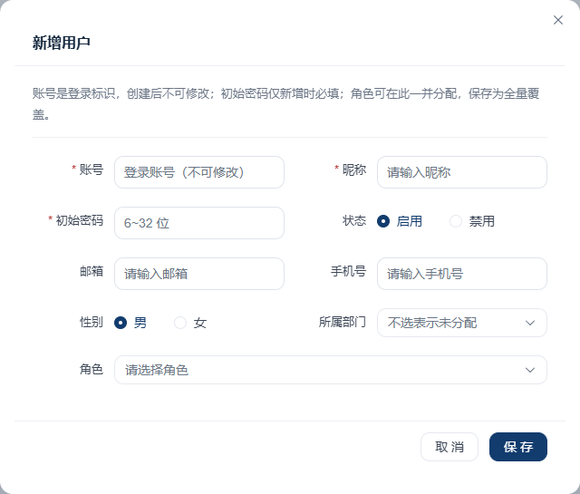

账号、昵称、初始密码（新增必填）、邮箱、手机号、性别、状态、角色；提交前做唯一性与角色存在性校验。

#### 1.4.2 分配角色弹层

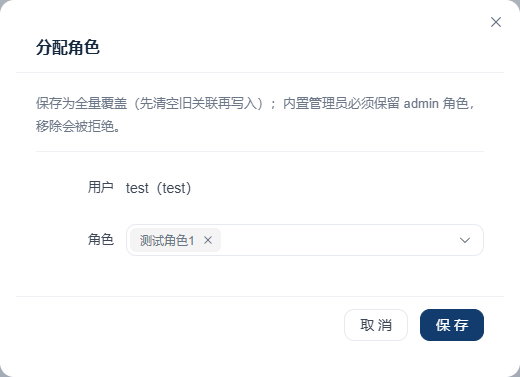

全量覆盖用户的角色（先逻辑删除旧关联再写入，关联表记录操作人 `update_by`）；
内置管理员必须保留 `admin` 角色，移除会被拒绝。

#### 1.4.3 重置密码弹层

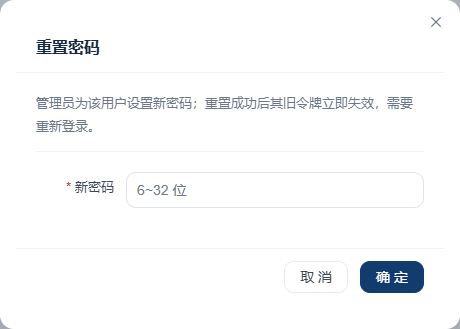

管理员为用户设置新密码；重置成功后该用户的旧令牌**立即失效**（需重新登录）。

### 1.5 角色管理

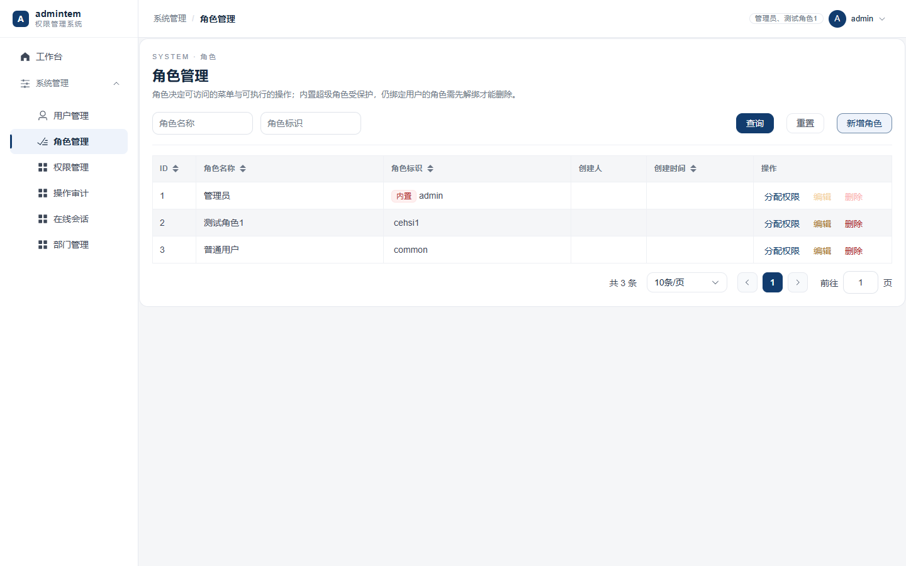

| 项 | 说明 |
| ---- | ---- |
| 路径 | `/roleInfo` |
| 权限 | 菜单标识 `userInfo:roleInfo` |
| 列表 | 角色 ID、名称、标识（`role_key`）、创建人、创建时间；支持按名称/标识模糊查询与列头排序 |
| 保护规则 | 内置超级角色 `admin` 不可删除、其标识不可修改；仍绑定用户的角色不可删除（返回 508） |
| 按钮权限 | 新增 `sysAuthRole:addAuthRole`、编辑 `sysAuthRole:editAuthRole`、分配权限 `sysAuthRole:assignPermission`、删除 `sysAuthRole:deleteById` |

#### 1.5.1 分配权限弹层

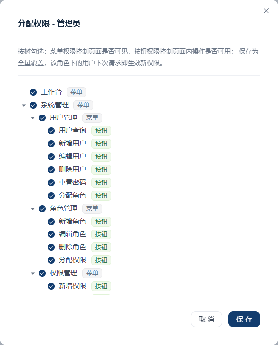

树形勾选菜单（`type=0`）与按钮（`type=1`）权限；保存为全量覆盖，
保存后该角色下用户的权限缓存立即失效，**重新登录或下次请求即生效新权限**。

#### 1.5.2 新增角色弹层

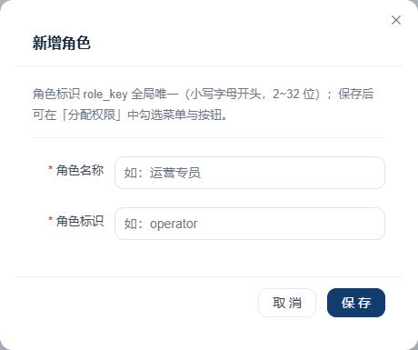

角色标识 `role_key` 全局唯一（格式：小写字母开头、字母数字下划线，2~32 位）。

### 1.6 权限管理

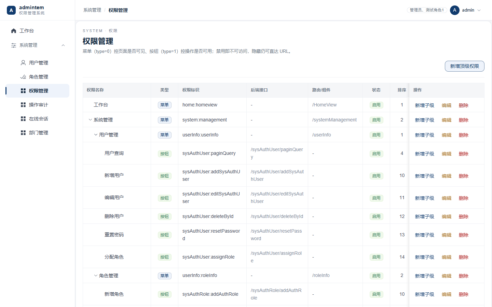

| 项 | 说明 |
| ---- | ---- |
| 路径 | `/permissionInfo` |
| 权限 | 菜单标识 `userInfo:permissionInfo` |
| 结构 | 菜单/按钮两级树表：名称、类型、路由、组件、后端接口、状态（0 启用/1 禁用）、展示（0 展示/1 隐藏）、图标、权限标识、排序号 |
| 语义 | 禁用（`status=1`）的菜单不下发、页面不可访问；隐藏（`show=1`）的菜单仍可 URL 直达，只是不出现在导航中（见《03》V1.0.3） |
| 保护规则 | 父级不能是自己或自己的子孙（防止父子成环）；删除菜单会级联删除其子孙与角色关联 |
| 按钮权限 | 新增 `sysAuthPermission:addAuthPermission`、编辑 `sysAuthPermission:editAuthPermission`、删除 `sysAuthPermission:deleteById` |

#### 1.6.1 新增权限弹层

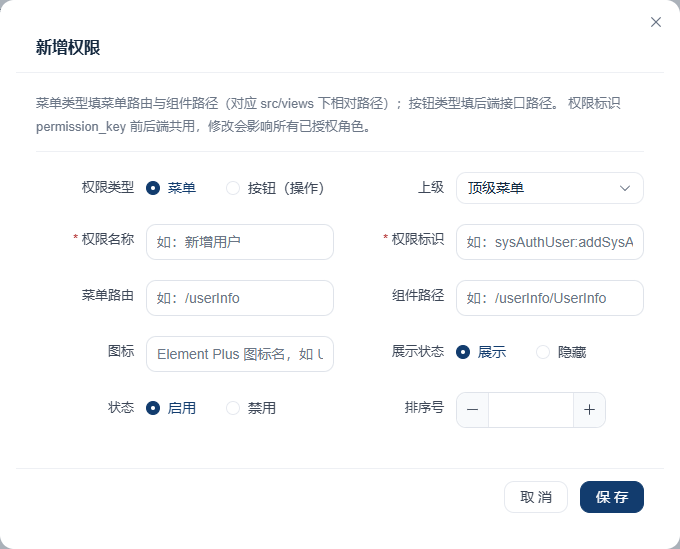

切换「类型」会改变可见字段：菜单类型需填路由与组件路径（对应前端 `src/views` 下相对路径），
按钮类型需填后端接口路径；`permission_key` 为前后端共用的权限标识。

### 1.7 操作审计

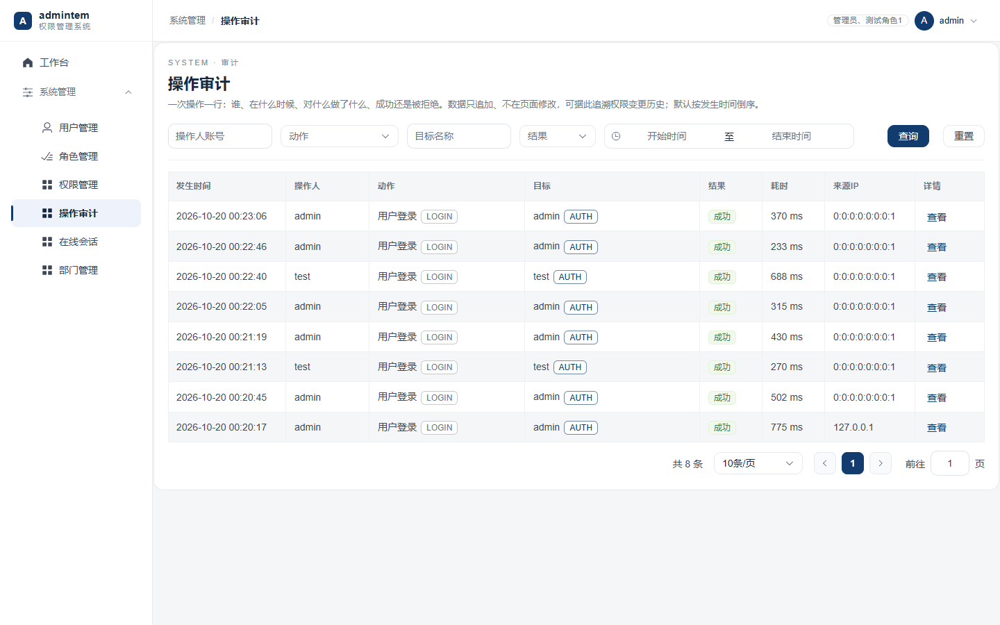

| 项 | 说明 |
| ---- | ---- |
| 路径 | `/auditLog`（菜单挂「系统管理」下，排序第 4；V1.0.7 新增） |
| 权限 | 菜单标识 `auditLog:auditLog`；查询与动作字典共用按钮标识 `sysAuthAuditLog:paginQuery` |
| 只读 | 无新增/编辑/删除入口：审计记录只追加，清理走运维 SQL（《04》6.6） |
| 筛选 | 操作人（前缀匹配）、动作（字典下拉，含出现次数）、目标名称、结果、时间范围（精确到秒，支持只选日期） |
| 列表 | 发生时间、操作人、动作（中文名 + 动作码）、目标（名称 + 类型标签）、结果、耗时、来源IP；默认按时间倒序，不可改排序 |
| 空状态 | 无数据时表格显示"暂无数据"；`操作人` 为空显示「（匿名）」，其余空值显示 `—` |

#### 1.7.1 明细抽屉

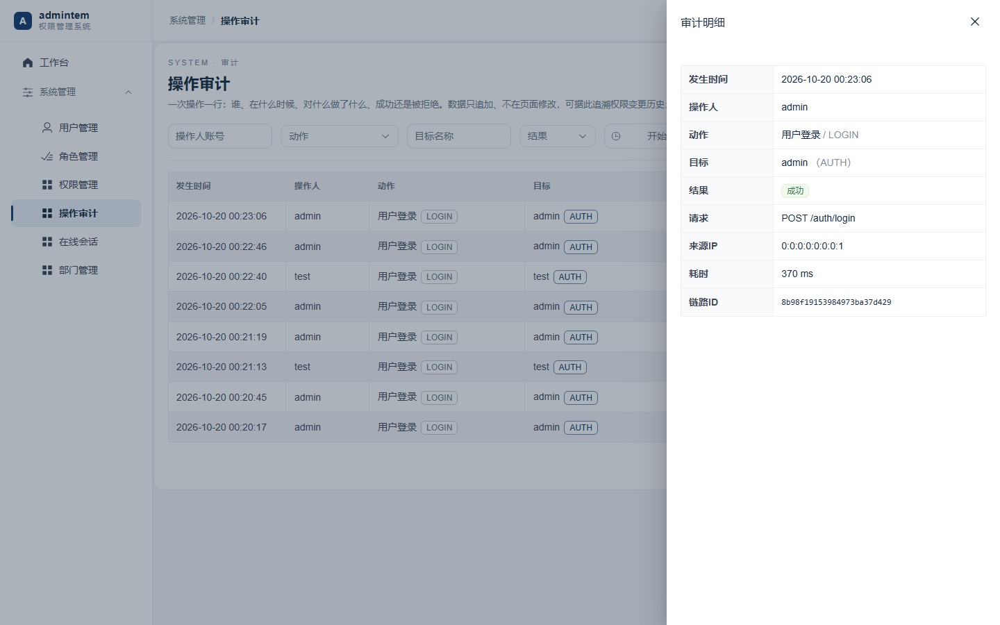

明细把不适合放进表格的字段集中展示：请求方法 + 路径、来源IP、耗时、失败码与失败原因，
以及 **`traceId`**——拿它可以直接在应用日志/SQL 日志里检索同一次请求的完整链路。

> 查询条件与页码会写回地址栏（`useQuerySync`），刷新或把链接发给同事都能保持同一视图。

### 1.8 在线会话

| 项 | 说明 |
| ---- | ---- |
| 路径 | `/onlineSession`（系统管理下，排序第 5；V1.0.8 新增） |
| 权限 | 菜单 `onlineSession:onlineSession`；强制下线 `sysAuthSession:kick` |
| 数据来源 | Redis 令牌白名单，不新增在线表 |
| 列表 | 账号（当前/锁定中标签）、昵称、角色、账号状态、剩余有效期、令牌摘要（前 8 位） |
| 操作 | 单条「强制下线」（二次确认）、「全部下线」（自动跳过当前会话） |
| 自我强踢保护 | 当前会话行的按钮禁用，提示改用「退出登录」 |
| 前端过滤 | 按账号/昵称本地过滤（在线人数少，无需后端分页） |

> 强制下线后，被踢账号的下一次请求即返回 401；这与用户主动退出登录走的是同一条路径（删除白名单 key）。

### 1.9 状态页
| 无权限页 | 页面不存在 |
| ---- | ---- |
| 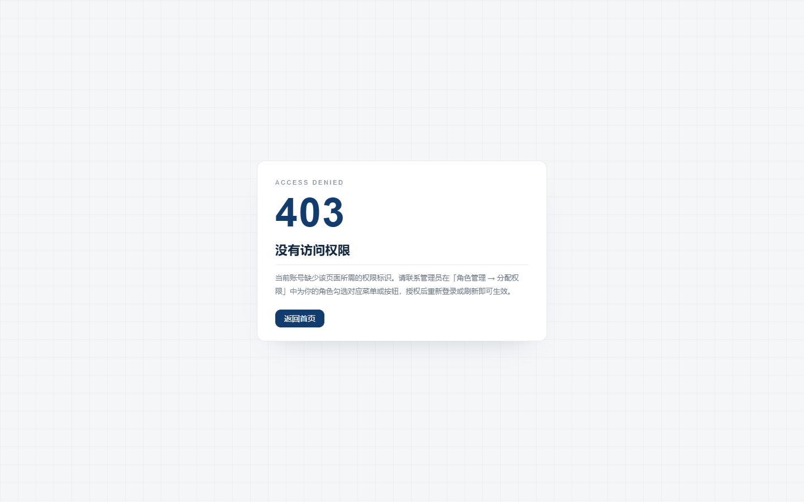 | 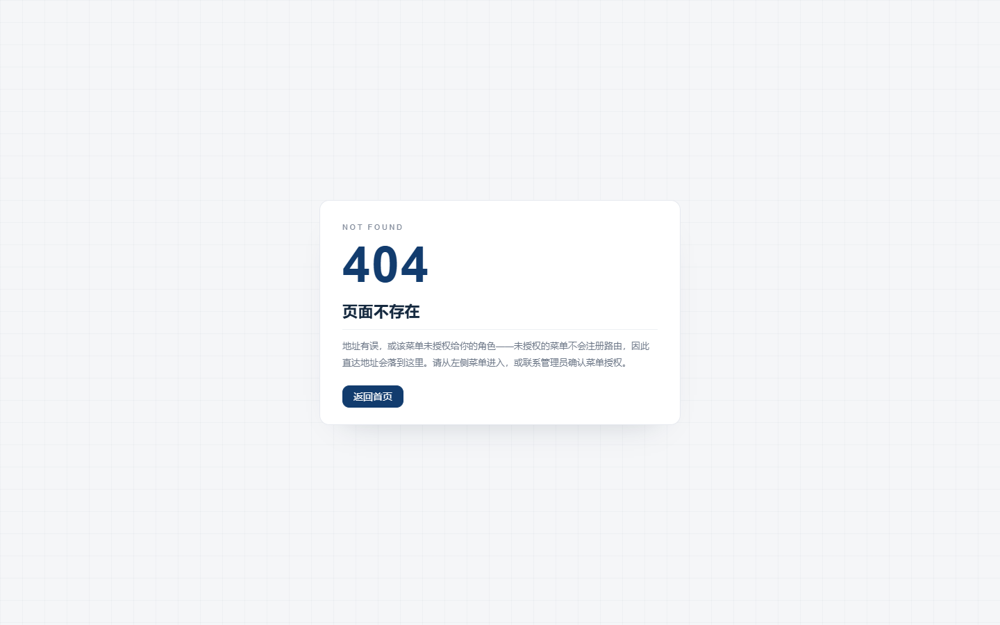 |

- **403**（`/403`）：登录后访问未授权页面时进入；也可由后端在按钮级权限不足时返回（HTTP 403）。
- **404**：访问未注册的地址时由兜底路由渲染；若某菜单未授权，其路由不会注册，同样落到此页。
- **视觉**：两页共用 `StatusPage` 组件——纸面画布 + 白卡，72px 主色数字、英文小标签（字距 2.6px）、
  中文标题与说明（上方细线分隔），右下角为返回工作台按钮；文案写明"为什么被拦 + 怎么处理"。

### 1.10 受限账号的界面差异（按钮级权限）

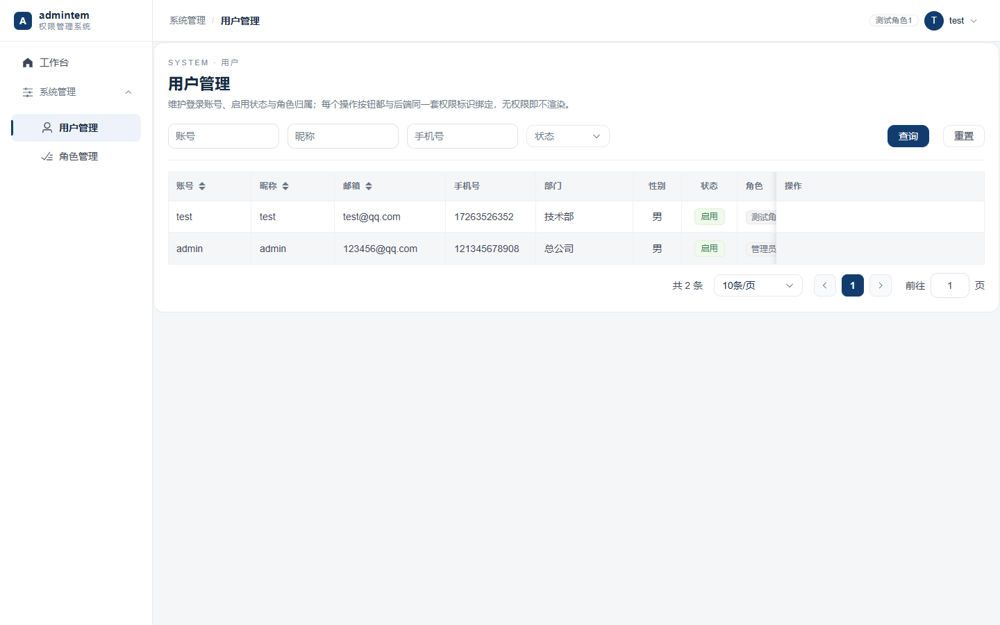

同一页面用 `test`（角色 `cehsi1`，仅有菜单权限、没有任何写按钮权限）登录后：
**新增/编辑/删除/分配角色/重置密码等按钮全部不渲染**——不是置灰，而是直接不出现在 DOM 中；
即使手工调用对应接口，后端也会因 `@PreAuthorize` 校验失败返回 403（见《06-测试报告》第 05 组断言）。

---

## 二、移动端

移动端与桌面端共用同一后端、同一套 `permission_key`，当前为基础版：登录后底部两个标签页。

### 2.1 登录页

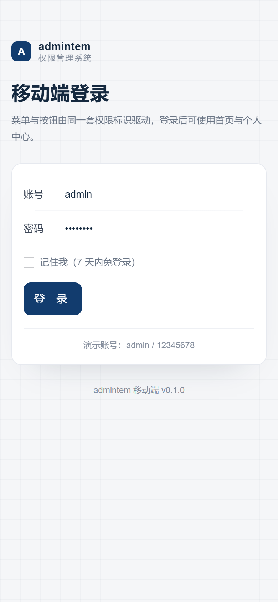

| 项 | 说明 |
| ---- | ---- |
| 路径 | `#/login`（hash 路由，静态托管无需服务端重写） |
| 操作 | 账号密码登录、记住我；登录后回跳来源页 |
| 说明 | 令牌与桌面端同构（`localStorage.admintem_token`、请求头 `admintem_token: LAUNCH <jwt>`） |
| 视觉 | 与桌面端同一套设计 token（色板/字号/圆角同名同值）；页首为品牌锁定（主色方块 + `admintem` 双行文字）+ 标题与说明，白卡承载表单，底部为演示账号与版本号 |

### 2.2 首页

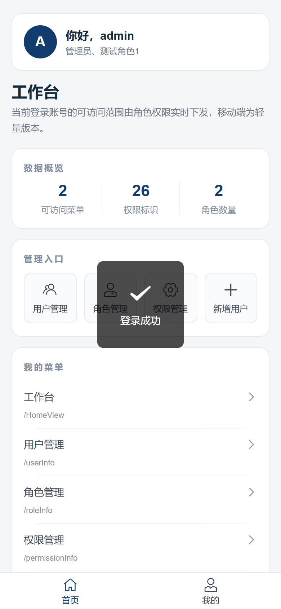

| 项 | 说明 |
| ---- | ---- |
| 路径 | `#/home` |
| 内容 | 欢迎信息（昵称/角色）、数据概览（可访问菜单数/权限标识数/角色数）、**按权限渲染的管理入口**、可访问菜单清单 |
| 权限效果 | 管理入口使用 `v-perm` 按 `permission_key` 渲染：`admin` 可见 4 项，`test` 仅可见其被授权的 2 项 |
| 边界 | 移动端不承载完整管理界面，点击入口会提示「请在桌面端使用」 |

### 2.3 我的

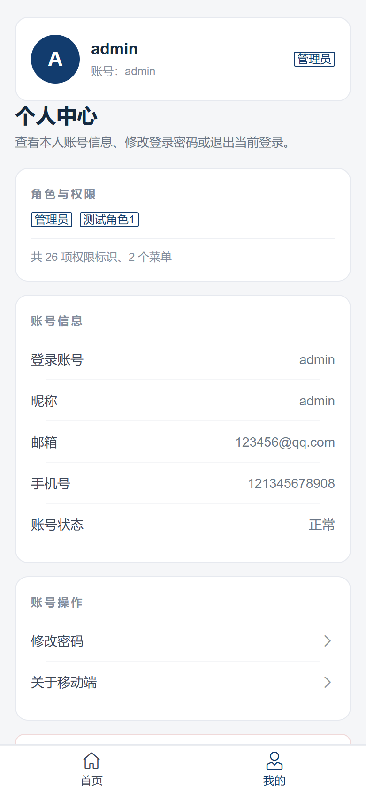

| 项 | 说明 |
| ---- | ---- |
| 路径 | `#/mine` |
| 内容 | 资料与角色标签、账号信息（账号/昵称/邮箱/手机号/状态）、修改密码、关于、退出登录（二次确认） |
| 退出 | 调用 `/auth/logout` 吊销服务端令牌并清理本地登录态 |

#### 2.3.1 修改密码弹层


提交后服务端会吊销当前令牌，前端强制回到登录页；旧密码随即失效，新密码方可登录
（该流程由 `tests/e2e-mobile-login.cjs` 的 J 组 9 项断言覆盖）。

---

## 三、界面与路由总览

| 端 | 页面 | 路由 | 菜单/权限标识 |
| ---- | ---- | ---- | ---- |
| 桌面 | 登录 | `/login` | 公开 |
| 桌面 | 注册 | `/register` | 公开（可用配置关闭） |
| 桌面 | 工作台 | `/HomeView` | `home:homeview` |
| 桌面 | 用户管理 | `/userInfo` | `userInfo:userInfo` |
| 桌面 | 角色管理 | `/roleInfo` | `userInfo:roleInfo` |
| 桌面 | 权限管理 | `/permissionInfo` | `userInfo:permissionInfo` |
| 桌面 | 无权限 | `/403` | 需登录 |
| 桌面 | 不存在 | 兜底路由 | — |
| 移动 | 登录 | `#/login` | 公开 |
| 移动 | 首页 | `#/home` | 需登录 |
| 移动 | 我的 | `#/mine` | 需登录 |

> 桌面端业务页面的路由由后端菜单动态注册（`component` 字段指向 `src/views` 下相对路径），
> 新增页面 = 放组件 + 登记菜单 + 授权角色，无需修改前端路由表。

## 四、截图维护

```powershell
# 前置：后端 8090、桌面端 5173、移动端 5174 均已启动
cd admintem-docs/tests
node capture-screenshots.cjs
# 产物：admintem-docs/images/*.png（19 张）+ images/manifest.json（文件名与体积清单）
```

- 脚本只做「打开页面 → 截图 → 关闭弹层」，**不提交任何表单**，不会产生业务数据；
- 登录等待采用「令牌写入且离开登录页」判定（而非固定等待），避免后端冷启动导致的整批截图失效；
- 截图命名固定（`desktop-01-login` … `mobile-04-password`），重拍即覆盖，文档引用无需改动；
- 界面改动后必须重拍并提交，提交信息注明"文档配图同步"。

**基线确定性**（像素比对要当证据用，就必须可复现）：脚本已固定三件事——
隐藏 dev 态的 Vue DevTools 浮层、截图前把鼠标移开（避免 hover 态入镜）、
弹层等待尺寸稳定（避免截到异步数据未回来的矮弹层）。
修正后同一脚本连续两次采集 19 张截图**逐像素完全一致**，因此"改动前后对比"里出现的差异
一定是真实界面变化，而不是环境噪声。

**界面改动的客观门槛**（与截图配套，先过脚本再提交）：

```powershell
cd admintem-docs/tests
node check-tokens.cjs        # token 引用/两端一致性
node check-design-a11y.cjs   # 对比度 + 三档宽度适配 + 触摸目标（123 项）
```
### 1.11 个人资料与头像

入口：右上角用户名下拉 →「个人资料」（任何已登录账号都有，不需要额外权限）。

| 项 | 说明 |
| ---- | ---- |
| 可改字段 | 昵称、性别、邮箱、手机号、个人介绍、头像 |
| 头像 | 点击头像选择图片（png / jpg / webp / gif，≤ 2MB）；上传成功后顶部头像立即更新，无需重新登录 |
| 校验 | 前端先做类型/大小提示；服务端再做大小、扩展名与**文件头**三重校验，任何一步不通过都会给出明确中文提示 |
| 存储 | 服务端生成 UUID 文件名，按月分目录存放；对外只暴露相对路径，前端按 API 基址拼完整 URL |
| 无头像时 | 顶部与弹窗都回退显示昵称首字母（不会出现破图） |

> 头像目录是**公开可读**的静态资源（`/uploads/avatar/**`），不要往里放合同、证件等敏感文件。
### 1.12 部门管理

| 项 | 说明 |
| ---- | ---- |
| 路径 | `/dept`（系统管理下，排序第 6；V1.0.9 新增） |
| 权限 | 菜单 `dept:dept`；新增/编辑/删除分别为 `sysAuthDept:addDept` / `editDept` / `deleteById` |
| 结构 | 树形表格（一次全量加载后展开），列：部门名称、负责人、联系电话、人数、排序、状态 |
| 操作 | 新增顶级部门、行内「新增子部门」、编辑、删除（含二次确认） |
| 上级选择 | 树选择器；编辑时**自动排除自己与自己的子孙**（后端也会再校验，防成环） |
| 删除保护 | 有子部门、或部门下仍有用户时由后端拒绝，并给出具体原因（如「存在子部门」） |
| 与用户的关系 | 用户表单新增「所属部门」选择（可选，未分配为空）；用户列表新增「部门」列 |

> 部门只表示归属，不影响菜单与按钮权限——把组织维度当授权维度是常见误解，这里刻意不做。