# 16 · Jenkins 自由风格任务部署教程（admintem 后台前后端）

> 本文记录一次**真实部署**：Jenkins 2.568.1 自由风格任务 → SSH 到 `192.168.1.167` → 使用服务器现有 **JDK 21 + Node 22 + Nginx 1.24** 构建并发布。
>
> 部署地址：<http://192.168.1.167:8092>　Jenkins：<http://100.71.112.119:8089>
>
> 约束：**不使用 Docker 部署本项目；不修改 MySQL / Redis 连接；不修改现有 Nginx 配置和现有服务；所有文件只落在 `/opt/admin-demo/`。**

---

## 0. 最终结果

| 项 | 值 |
| ---- | ---- |
| 前端地址 | <http://192.168.1.167:8092>（同机 Tailscale 可用 `http://100.71.112.119:8092`） |
| 后端地址 | `http://127.0.0.1:8090`（仅本机监听，由 Nginx 同源反代） |
| Jenkins 任务 | `admin-demo-deploy`（Freestyle project） |
| 部署目录 | `/opt/admin-demo/` |
| 运行用户 | `root`（演示环境；生产建议专用 `deploy` 用户） |
| 数据库 | 沿用 `jdbc:mysql://100.71.112.119:3306/admintem_new` |
| Redis | 沿用 `redis://100.71.112.119:6379` database 0 |
| 构建工具 | 服务器 JDK `21.0.12.1`、Maven `3.8.7`、Node `v22.23.2`、npm `10.9.8` |
| Nginx | `/usr/sbin/nginx`，独立配置/独立进程，监听 **8092** |
| 最后一次构建 | **#3 SUCCESS**（约 2 分 3 秒，依赖已缓存） |

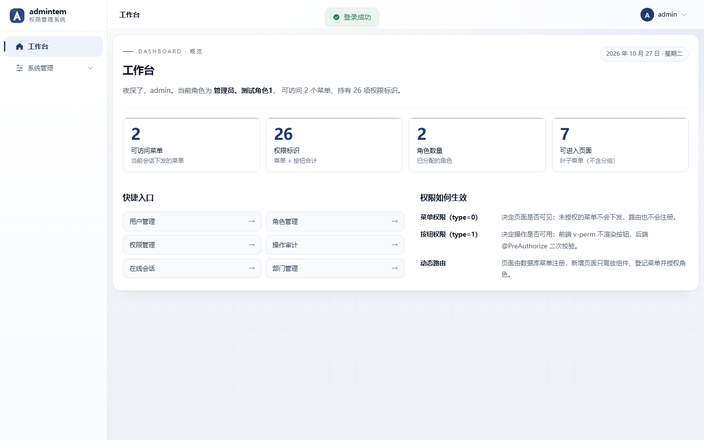

---

## 1. 部署架构

```text
浏览器
  │  http://192.168.1.167:8092
  ▼
独立 Nginx（/usr/sbin/nginx -p /opt/admin-demo/nginx，8092）
  ├─ /                 → /opt/admin-demo/frontend（Vue3 构建产物，history fallback）
  └─ /auth /sysAuth /uploads /actuator /v3
                         → http://127.0.0.1:8090（Spring Boot）
                                                   │
                                      MySQL 3306 / Redis 6379（保持原连接）
```

Jenkins 本身运行在 Docker 里，但**本项目不把应用跑在 Docker 里**：Jenkins 只负责触发和展示日志，实际构建/运行在宿主机 `192.168.1.167` 上。

---

## 2. 服务器预检（只读）

先确认现有环境，不安装、不修改任何东西：

```bash
hostname; uname -a; cat /etc/os-release | head -3
readlink -f "$(which java)"; java -version
which node; node -v; which npm; npm -v
which mvn; mvn -v
ls -l /usr/sbin/nginx; /usr/sbin/nginx -v
ss -lntp | grep -E ':8090|:8092' || echo '8090/8092 free'
```

实际结果：

| 检查项 | 结果 |
| ---- | ---- |
| 系统 | Ubuntu 24.04.4 LTS，x86_64 |
| JDK | `/usr/lib/jvm/java-21-openjdk-amd64`，21.0.12.1 |
| Node / npm | v22.23.2 / 10.9.8 |
| Maven | 3.8.7 |
| Nginx | `/usr/sbin/nginx`，1.24.0 |
| MySQL | `127.0.0.1:3306` 可连接（8.4.5） |
| Redis | `127.0.0.1:6379` 可连接 |
| 8090 / 8092 | 均未被占用 |

> Jenkins 容器内没有 Node/Maven，所以没有在 Jenkins 容器里构建；任务通过 SSH 调用宿主机脚本，使用宿主机 JDK21/Node。

---

## 3. 目录与端口规划

只新增一个目录，不碰其他项目：

```text
/opt/admin-demo/
├── src/                 # Gitee 拉取的源码
├── backend/             # admintem-backend.jar
├── frontend/            # Vue dist（Nginx root）
├── config/
│   └── application-local.yml   # 数据库/Redis 密码，600，禁止入 Git
├── nginx/
│   ├── nginx.conf       # 独立 Nginx 配置
│   └── nginx.pid
├── logs/                # backend.out、nginx-*.log
├── run/backend.pid
├── uploads/avatar/      # 头像文件
└── deploy.sh            # Jenkins 调用的部署脚本
```

创建命令：

```bash
mkdir -p /opt/admin-demo/{src,backend,frontend,config,nginx,logs,run,uploads/avatar}
chmod 700 /opt/admin-demo/config
```

> **没有修改** `/etc/nginx/`、MySQL、Redis、Jenkins 容器以外的系统服务，也没有重启现有 Docker 容器。

---

## 4. 准备 SSH 密钥（Jenkins → 目标机）

Jenkins 容器内只有 `ssh`，没有 `sshpass`，所以用密钥而不是在任务里写密码。

### 4.1 生成密钥并授权

在目标机执行（或本地生成后上传）：

```bash
ssh-keygen -t ed25519 -f /opt/admin-demo/.ssh/deploy_key -N '' -C jenkins-admin-demo
chmod 700 /root/.ssh /opt/admin-demo/.ssh
chmod 600 /root/.ssh/authorized_keys /opt/admin-demo/.ssh/deploy_key
cat /opt/admin-demo/.ssh/deploy_key.pub >> /root/.ssh/authorized_keys
```

### 4.2 把私钥放进 Jenkins 容器

```bash
docker exec -u root 1Panel-jenkins-hh51 mkdir -p /var/jenkins_home/.ssh
docker cp /opt/admin-demo/.ssh/deploy_key \
  1Panel-jenkins-hh51:/var/jenkins_home/.ssh/admin_demo
docker exec -u root 1Panel-jenkins-hh51 \
  sh -c 'chown -R jenkins:jenkins /var/jenkins_home/.ssh && chmod 700 /var/jenkins_home/.ssh && chmod 600 /var/jenkins_home/.ssh/admin_demo'
```

### 4.3 验证

```bash
docker exec 1Panel-jenkins-hh51 \
  ssh -i /var/jenkins_home/.ssh/admin_demo \
  -o StrictHostKeyChecking=no -o UserKnownHostsFile=/dev/null \
  root@192.168.1.167 'hostname; java -version 2>&1 | head -1; node -v'
```

输出：

```text
lw-Vostro-7580
openjdk version "21.0.12.1" 2026-08-18
v22.23.2
```

> 生产建议：不要用 root 密码/root 账号，改为专用 `deploy` 用户 + Jenkins Credentials（SSH Username with private key）+ 限制命令的 `authorized_keys`。本教程为内网演示使用 root。

---

## 5. 服务器配置

### 5.1 数据源配置（不入 Git）

`/opt/admin-demo/config/application-local.yml`，权限 `600`：

```yaml
ADMINTEM_DB_PASSWORD: "<MySQL root 密码>"
ADMINTEM_REDIS_PASSWORD: "<Redis 密码>"
ADMINTEM_MINIO_SECRET_KEY: "<MinIO secret，可选；local 存储不需要>"
```

`application-dev.yml` 里的地址保持不变：

```yaml
datasource:
  url: jdbc:mysql://100.71.112.119:3306/admintem_new?...
  username: root
  password: ${ADMINTEM_DB_PASSWORD:}
redisson:
  address: redis://100.71.112.119:6379
  password: ${ADMINTEM_REDIS_PASSWORD:}
  database: 0
```

> 没有改库名、地址、密码；Flyway 启动时校验 11 个迁移，当前版本 `1.0.10`，未做额外迁移。

### 5.2 独立 Nginx 配置

**不修改 `/etc/nginx`**，新建 `/opt/admin-demo/nginx/nginx.conf`：

```nginx
worker_processes 1;
user www-data;
pid /opt/admin-demo/nginx/nginx.pid;
error_log /opt/admin-demo/logs/nginx-error.log warn;

events { worker_connections 1024; }

http {
    include /etc/nginx/mime.types;
    default_type application/octet-stream;
    sendfile on;
    client_max_body_size 10m;
    access_log /opt/admin-demo/logs/nginx-access.log;

    server {
        listen 8092;
        server_name _;
        root /opt/admin-demo/frontend;
        index index.html;

        location / { try_files $uri $uri/ /index.html; }

        location ~ ^/(auth|sysAuth|uploads|actuator|swagger-ui|v3)/ {
            proxy_pass http://127.0.0.1:8090;
            proxy_http_version 1.1;
            proxy_set_header Host $host;
            proxy_set_header X-Real-IP $remote_addr;
            proxy_set_header X-Forwarded-For $proxy_add_x_forwarded_for;
            proxy_set_header X-Forwarded-Proto $scheme;
            proxy_read_timeout 60s;
        }
    }
}
```

检查并启动：

```bash
/usr/sbin/nginx -t -p /opt/admin-demo/nginx -c /opt/admin-demo/nginx/nginx.conf
/usr/sbin/nginx -p /opt/admin-demo/nginx -c /opt/admin-demo/nginx/nginx.conf
curl -I http://127.0.0.1:8092/
```

### 5.3 后端启动参数（关键）

```bash
/usr/lib/jvm/java-21-openjdk-amd64/bin/java \
  -XX:MaxRAMPercentage=60 -Dfile.encoding=UTF-8 \
  -jar /opt/admin-demo/backend/admintem-backend.jar \
  --spring.profiles.active=dev \
  --server.port=8090 \
  --admintem.security.cors-allowed-origins='http://localhost:*,http://127.0.0.1:*,http://192.168.1.167:8092'
```

> **踩坑点**：后端默认只允许 `localhost` 跨域，而浏览器同源页面发 POST 时仍会带 `Origin: http://192.168.1.167:8092`。
> 不补这个参数，验证码 POST 会 403（页面提示“验证码加载失败”）。该参数只在启动命令中，不改代码/全局配置。

---

## 6. Jenkins：新建自由风格任务

### 6.1 登录

打开 <http://100.71.112.119:8089/login>，用 `admin / 123456` 登录。

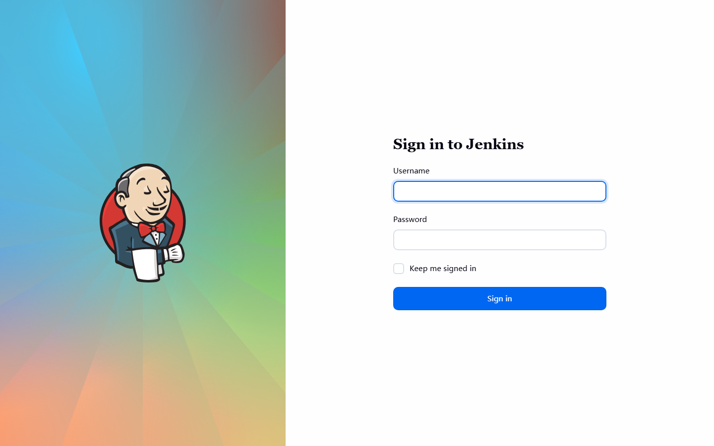

登录后进入 Dashboard：

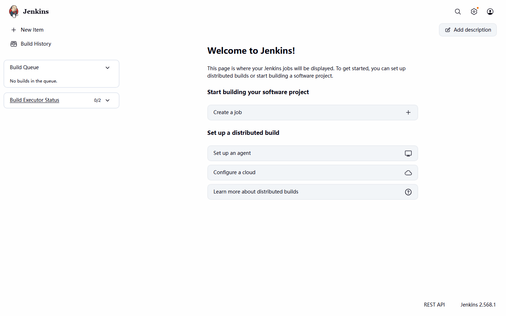

### 6.2 New Item

点击左侧 **New Item**，输入任务名 `admin-demo-deploy`，选择 **Freestyle project**，点 **OK**。

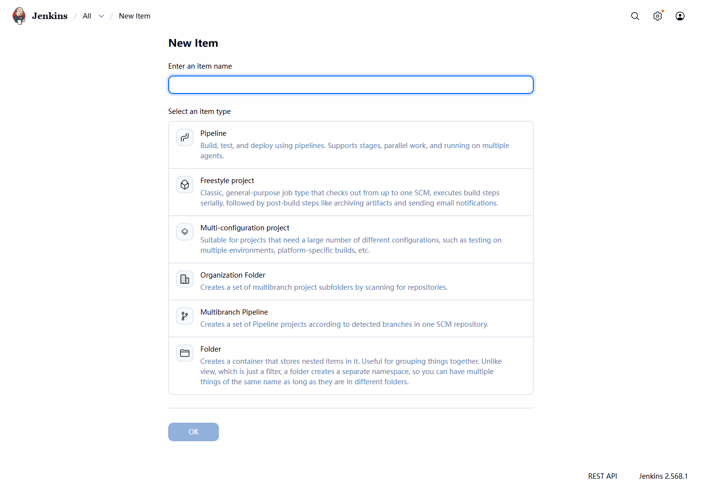

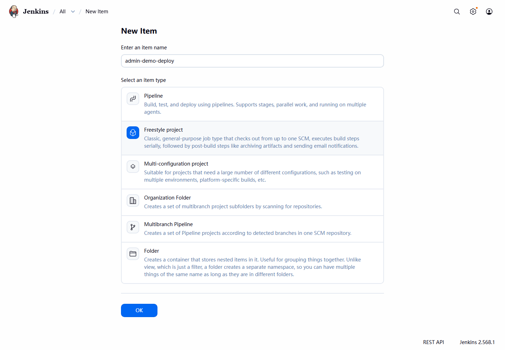

### 6.3 General

- Description 填：

```text
admintem 后台模板：JDK21 + 本机 Node 构建，部署到 /opt/admin-demo，独立 Nginx 8092，不修改现有服务。
```

- 其余保持默认；不需要参数化构建。

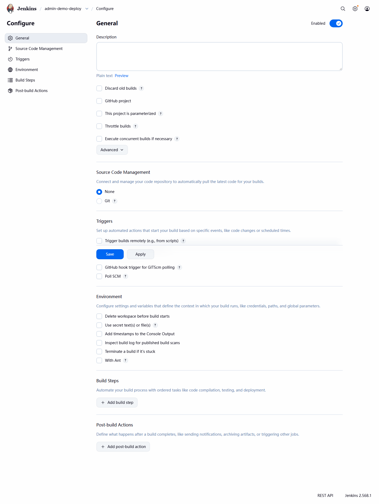

### 6.4 Source Code Management

选择 **None**。

原因：该任务的职责是“触发目标机部署脚本”，源码同步在目标机 `deploy.sh` 内通过 Gitee 完成；Jenkins 容器不装 Node/Maven，避免在 Jenkins 工作区重复构建。

> 如果希望 Jenkins 保存构建变更记录，可改为 Git SCM 指向公开仓库；但实际构建仍建议固定在目标机执行，避免两套环境不一致。

### 6.5 Build Steps

点击 **Add build step → Execute shell**，填入：

```bash
set -e
ssh -i /var/jenkins_home/.ssh/admin_demo \
  -o StrictHostKeyChecking=no \
  -o UserKnownHostsFile=/dev/null \
  root@192.168.1.167 'bash /opt/admin-demo/deploy.sh'
```

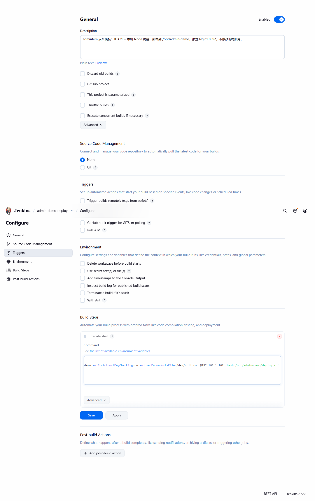

点击 **Save**。

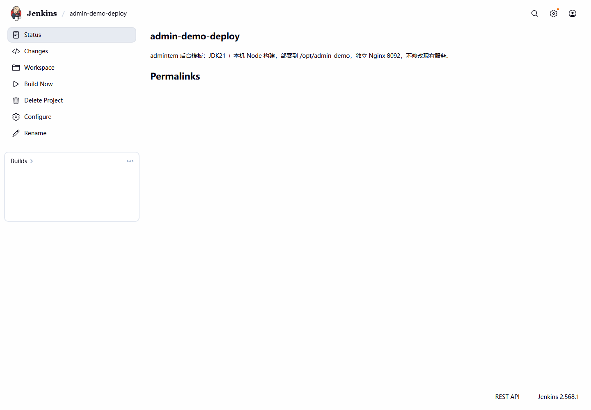

---

## 7. 触发构建

在任务页点击 **Build Now**：

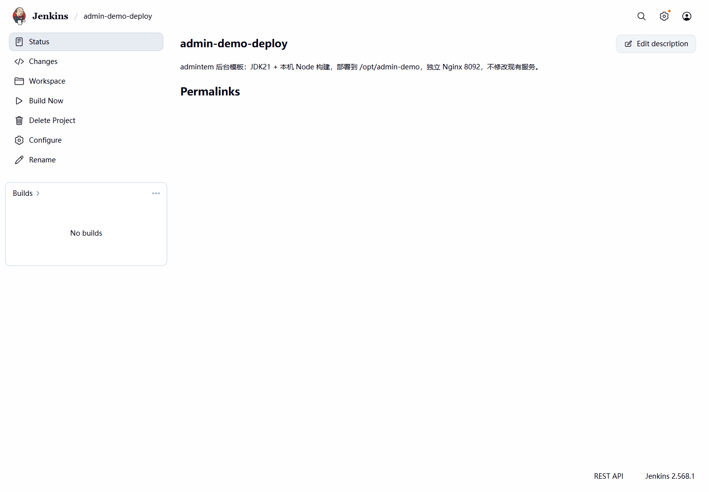

构建进入队列/执行：

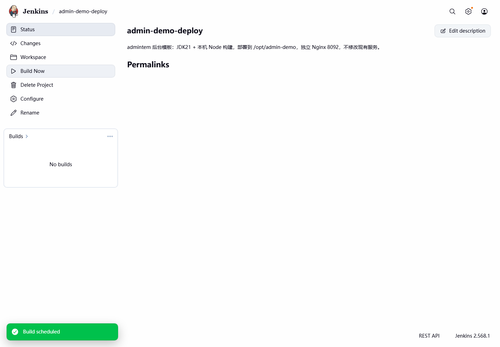

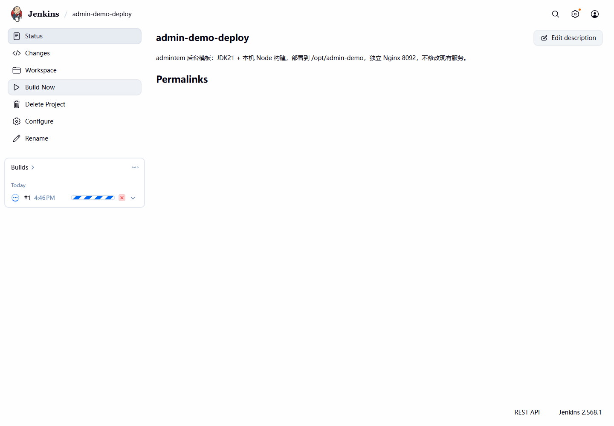

最终任务页显示 **#3 成功**：

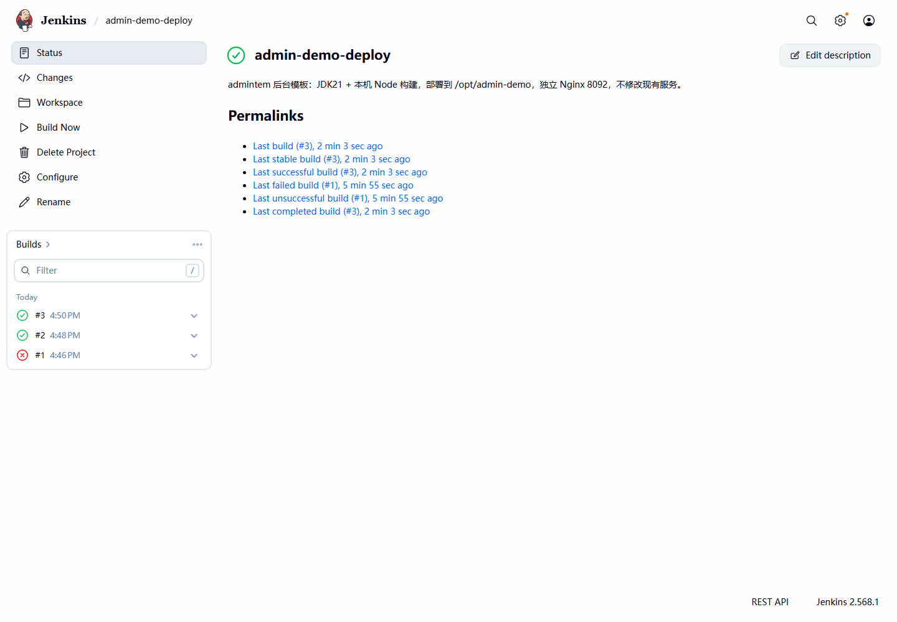

---

## 8. 构建过程（控制台）

构建日志在任务页 **Console Output**：

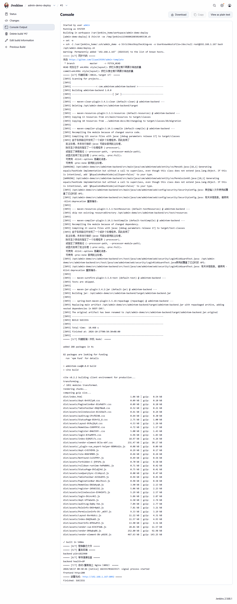

关键阶段：

```text
===== [1/7] 同步代码 =====
commit=e4c496c style(layout)：顶栏头像左侧不再展示角色胶囊

===== [2/7] 构建后端（JDK21，target 17） =====
BUILD SUCCESS
Total time: 6.498 s

===== [3/7] 构建前端（本机 Node） =====
added 288 packages in 4s
vite v8.2.2 building client environment for production...
✓ built in 548ms

===== [4/7] 替换静态文件 =====
===== [5/7] 重启后端 =====
backend pid=1822960
===== [6/7] 等待健康检查 =====
backend health=UP
===== [7/7] 启动/重载独立 Nginx（8092） =====
frontend http=200
===== 部署完成: http://192.168.1.167:8092 =====
Finished: SUCCESS
```

构建耗时约 **2 分 3 秒**（第 2、3 次依赖已缓存；首次约 1 分钟 Maven 下载）。

完整日志见 [build-3-console.txt](jenkins-deploy/build-3-console.txt)。

---

## 9. 部署验证

### 9.1 登录页

打开 <http://192.168.1.167:8092>：

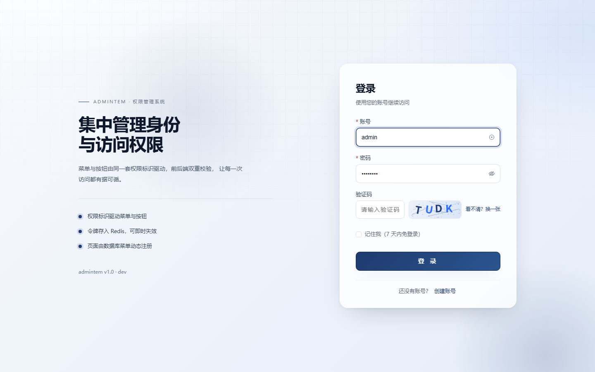

### 9.2 登录进入工作台

使用 `admin / 12345678` 登录，验证码通过后进入 `/HomeView`：


### 9.3 接口与 SPA 刷新

```text
GET  http://192.168.1.167:8092/actuator/health   → 200 {"status":"UP"}
GET  http://192.168.1.167:8092/userInfo           → 200（Nginx history fallback 返回 index.html）
POST http://192.168.1.167:8092/auth/captcha       → 200（不再 403）
GET  http://192.168.1.167:8092/uploads/avatar/... → 200
```

浏览器控制台：无 4xx 资源、无 JS 报错。

---

## 10. 部署脚本说明

完整脚本见 [deploy.sh](jenkins-deploy/deploy.sh)，核心步骤：

| 步骤 | 做什么 | 关键点 |
| ---- | ---- | ---- |
| 1/7 | `git fetch` / `reset --hard origin/master` | 公开 Gitee 仓库；保证构建内容可追溯 |
| 2/7 | `mvn -B -Pdev -DskipTests clean package` | JDK21 构建，项目 target 17；演示跳过测试 |
| 3/7 | `npm ci && npm run build` | 使用服务器已有 Node 22；`.env.production` 的 API base 为空 |
| 4/7 | 替换 frontend / jar | 先构建到 `.new`，成功后再替换，避免半成品 |
| 5/7 | kill 旧 PID，启动新 jar | PID 文件 `/opt/admin-demo/run/backend.pid` |
| 6/7 | 轮询 `/actuator/health` | 最长 120 秒；失败打印最后 80 行日志并退出 1 |
| 7/7 | 独立 Nginx 启动/重载 | PID 为空或进程不在时重新启动，避免空 PID `reload` 失败 |

> 生产建议：把 `-DskipTests` 改成完整测试；或拆成“构建”和“部署”两个自由风格任务，部署任务只允许发布已归档的 jar。

---

## 11. 日常操作

### 11.1 发布新版本

1. 本地 `git push` 到 Gitee `master`；
2. Jenkins 打开 `admin-demo-deploy` → **Build Now**；
3. 看 Console 最后一行是否为 `Finished: SUCCESS`；
4. 打开 8092 验证。

### 11.2 查看日志

```bash
tail -f /opt/admin-demo/logs/backend.out
tail -f /opt/admin-demo/logs/nginx-access.log
tail -f /opt/admin-demo/logs/nginx-error.log
```

### 11.3 重启 / 停止

```bash
# 后端
kill "$(cat /opt/admin-demo/run/backend.pid)"
# 重新执行 Jenkins 任务即可拉起

# 独立 Nginx
/usr/sbin/nginx -p /opt/admin-demo/nginx -c /opt/admin-demo/nginx/nginx.conf -s reload
/usr/sbin/nginx -p /opt/admin-demo/nginx -c /opt/admin-demo/nginx/nginx.conf -s quit
```

### 11.4 回滚

当前脚本按 `origin/master` 构建，回滚有两种方式：

1. 在 Gitee 上将 `master` 回退到目标提交，再点 Build Now；
2. 登录服务器，在 `/opt/admin-demo/src` 执行 `git reset --hard <commit>`，临时把 `deploy.sh` 的 `git reset --hard origin/master` 改为该提交，再执行脚本。

> 生产建议给 `deploy.sh` 增加 `DEPLOY_REF` 参数，并在 Jenkins 任务中做成字符串参数，回滚只需填 commit。

---

## 12. 本次踩坑与修复

| 现象 | 原因 | 修复 |
| ---- | ---- | ---- |
| Build #1：`invalid PID number "" in nginx.pid` | `nginx -t`/上次失败留下空 pid 文件，脚本直接 `-s reload` | 先判断 pid 文件非空且进程存活，否则删 pid 后重新启动 |
| 页面“验证码加载失败”，POST `/auth/captcha` 403 | 部署域名不在后端 CORS 白名单（默认只允许 localhost） | 启动参数增加 `--admintem.security.cors-allowed-origins=...192.168.1.167:8092` |
| 头像 404 | 数据库沿用旧数据，但 `/opt/admin-demo/uploads` 为空 | 把原 `uploads/avatar` 文件同步到部署目录（本次 3 个文件） |
| Jenkins 容器没有 Node/Maven | Jenkins 镜像只负责调度 | 构建放到目标机执行，Jenkins 通过 SSH 触发 |

---

## 13. 截图索引（操作留痕）

| 步骤 | 截图 |
| ---- | ---- |
| Jenkins 登录页 | [01-jenkins-login.png](jenkins-deploy/01-jenkins-login.png) |
| 登录后 Dashboard | [02-jenkins-dashboard.png](jenkins-deploy/02-jenkins-dashboard.png) |
| New Item | [05-new-item.png](jenkins-deploy/05-new-item.png) |
| 选择 Freestyle project | [06-new-item-freestyle.png](jenkins-deploy/06-new-item-freestyle.png) |
| General 配置 | [07-job-config.png](jenkins-deploy/07-job-config.png) |
| Execute shell 构建步骤 | [08-job-build-step.png](jenkins-deploy/08-job-build-step.png) |
| 保存后的任务页 | [09-job-saved.png](jenkins-deploy/09-job-saved.png) |
| 构建前 | [10-job-before-build.png](jenkins-deploy/10-job-before-build.png) |
| 构建排队 | [11-build-queued.png](jenkins-deploy/11-build-queued.png) |
| 构建运行中 | [12-build-running.png](jenkins-deploy/12-build-running.png) |
| 第三次构建排队 | [19-build3-queued.png](jenkins-deploy/19-build3-queued.png) |
| Build #3 控制台 | [20-build3-console.png](jenkins-deploy/20-build3-console.png) |
| 构建历史（#3 成功） | [23-job-final.png](jenkins-deploy/23-job-final.png) |
| 部署后登录页 | [21-deployed-login.png](jenkins-deploy/21-deployed-login.png) |
| 部署后工作台 | [22-deployed-dashboard.png](jenkins-deploy/22-deployed-dashboard.png) |

---

## 14. 安全与边界

- **未修改**：MySQL、Redis、`/etc/nginx`、现有 Nginx 服务、其他 Docker 容器、系统级环境变量；
- **新增**：`/opt/admin-demo/`、`/root/.ssh/authorized_keys` 中一条部署公钥、Jenkins 容器内 `/var/jenkins_home/.ssh/admin_demo`、独立 Nginx 8092 进程；
- 数据库/Redis 密码只存在服务器 `/opt/admin-demo/config/application-local.yml`（600），不进入 Git；
- Jenkins 私钥只在 Jenkins 容器内（600），任务配置只引用路径，不出现密码；
- 本教程所有截图不包含密码、私钥、数据库口令；
- 演示使用 root + `-DskipTests`，生产请替换为专用用户、完整测试、凭据管理、Nginx HTTPS 与日志轮转。
